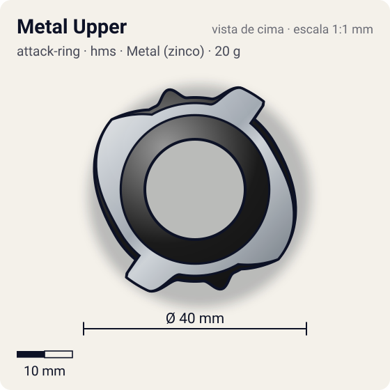
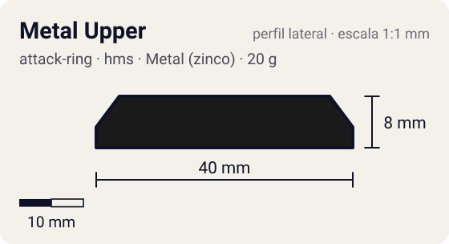

# Metal Upper

<!-- auto:inicio (gerado por npm run build:research; não edite este bloco) -->
 

| Medidas e material | |
|---|---|
| Diâmetro | 40 estimado mm |
| Altura / espessura | 8 estimado mm |
| Peso | 20 wiki g |
| Material | Metal (zinco) + ABS (metalico) |
| Estrelas Takara (A / D / S) | 2 / 2 / 3 |
| Usada em | [Driger MS](../../../personagens/ray-kon/beyblades/driger-ms/) |
<!-- auto:fim -->

| Campo | Valor |
|---|---|
| Id | `attack-ring/metal-upper` |
| Categoria | Attack Ring |
| Sistema | Hard Metal System (HMS) |
| Material | Metal (zinco) + ABS |
| Acabamento | metalico |
| Cores (primária / secundária / detalhe) | `#1a1a1a` / `#9ea3a8` / `#f2c230` |

## Beys que usam

- `ray-kon/driger-ms` ([ficha](../../../personagens/ray-kon/beyblades/driger-ms/README.md))

## Formato

Compacto (~40 mm). Simetria 2: em cada lado, uma **cabeça de tigre** metálica com face reta virada para o sentido anti-horário (~20 mm) e, depois, uma **rampa longa** de metal que sobe por ~70° até ~19,5 mm. A capa ABS preenche o anel com bossas arredondadas.

AR de HMS baixo e de diâmetro pequeno: moldura metálica com rampas e cabeças de tigre + capa ABS.

## Função em batalha

Upper sólido na direita; smash/spike na esquerda com as cabeças de tigre (onde está a maior parte do metal).

## Reação por sentido de rotação

- **Direita (horário visto de cima):** As rampas lideram: upper sólido.
- **Esquerda (anti-horário):** As faces das cabeças de tigre lideram: smash e spike.
- Sentido ótimo: **ambos**. Tipo de contato: **upper**, 2 contato(s), recoil 0,35 (0–1, estimado).

## Combos conhecidos

- Wiki: recomendado para compactos, mas obsoleto diante de peças mais novas.

## Medidas, material e stats

| Item | Valor | Fonte |
|---|---|---|
| Diâmetro | 40 mm | estimado (2 × maior raio da `forma`) |
| Altura | 8 mm | estimado |
| Peso | 20 g | wiki |
| Material | Metal (zinco) + ABS | Metal Frame com rampas e cabeças de tigre + ABS Caul. |
| Ataque / Defesa / Stamina | 2 / 2 / 3 | Beyblade Wiki, tabela de estrelas da página Driger MS (a peça não tem página própria) |
| Raio de contato | 20 mm | estimado |

## Forma (parâmetros do gerador de SVG)

Convenção: ângulos em graus, sentido horário visto de cima, 0° = topo; o setor (0 a 180°) se repete 2 vezes. Na rotação **direita** a face em `fim` é a que bate; na **esquerda**, a face em `inicio`. Anel base com raio 16,5 mm, furo central 9 mm, espessura 8 mm. `forma.moldura` descreve só a moldura metálica (simetria 2).

| início | pico | fim | raio (mm) | borda | altura (mm) | material |
|---|---|---|---|---|---|---|
| 10° | 25° | 40° | 20 | reta | 8 | metal |
| 60° | 130° | 150° | 19,5 | rampa | 7 | metal |
| 155° | 165° | 175° | 18,5 | curva | 7 | ABS/PC |

## Observações

Sem página própria na wiki; dados da página Driger MS. Cor da capa aproximada.

## Referências locais

- Nenhuma foto local desta peça no repositório.

## Fontes

- https://beyblade.fandom.com/wiki/Driger_MS
