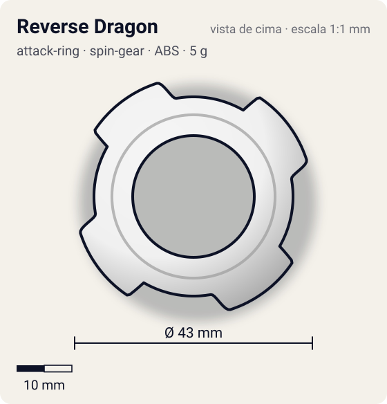
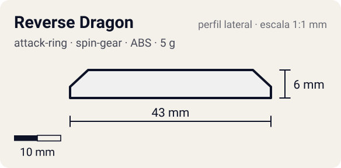

# Reverse Dragon

<!-- auto:inicio (gerado por npm run build:research; não edite este bloco) -->
 

| Medidas e material | |
|---|---|
| Diâmetro | 43 estimado mm |
| Altura / espessura | 6 estimado mm |
| Peso | 5 wiki g |
| Material | ABS (opaco) |
| Estrelas Takara (A / D / S) | 2 / 2 / 2 |
| Usada em | [Dragoon S (Dragoon Storm)](../../../personagens/tyson-granger/beyblades/dragoon-s/) |
<!-- auto:fim -->

| Campo | Valor |
|---|---|
| Id | `attack-ring/reverse-dragon` |
| Categoria | Attack Ring |
| Sistema | Spin Gear System |
| Material | ABS |
| Acabamento | opaco |
| Cores (primária / secundária / detalhe) | `#f0f0f0` / `#d8262c` / `#1a1a1a` |

## Beys que usam

- `tyson-granger/dragoon-s` ([ficha](../../../personagens/tyson-granger/beyblades/dragoon-s/README.md))

## Formato

Simetria 4. **4 lâminas** com face de ataque reta virada para o sentido anti-horário (~21,5 mm) que se afinam por ~40° até o anel. Branco com adesivos vermelhos e pretos (verde e roxo nas primeiras versões).

Primeiro AR feito para atacar em rotação esquerda: 4 bordas de ataque; branco com detalhes vermelhos e pretos.

## Função em batalha

Smash em contra-rotação contra beys de rotação direita.

## Reação por sentido de rotação

- **Direita (horário visto de cima):** Lideram as caudas: pouco dano.
- **Esquerda (anti-horário):** Sentido de fábrica: faces retas lideram, smash.
- Sentido ótimo: **esquerda**. Tipo de contato: **smash**, 4 contato(s), recoil 0,5 (0–1, estimado).

## Combos conhecidos

- Nenhum combo documentado nas fontes.

## Medidas, material e stats

| Item | Valor | Fonte |
|---|---|---|
| Diâmetro | 43 mm | estimado (2 × maior raio da `forma`) |
| Altura | 6 mm | estimado |
| Peso | 5 g | wiki |
| Material | ABS | — |
| Ataque / Defesa / Stamina | 2 / 2 / 2 | Beyblade Wiki, Part Infobox |
| Raio de contato | 21,5 mm | estimado |

## Forma (parâmetros do gerador de SVG)

Convenção: ângulos em graus, sentido horário visto de cima, 0° = topo; o setor (0 a 90°) se repete 4 vezes. Na rotação **direita** a face em `fim` é a que bate; na **esquerda**, a face em `inicio`. Anel base com raio 18 mm, furo central 11 mm, espessura 6 mm.

| início | pico | fim | raio (mm) | borda | altura (mm) | material |
|---|---|---|---|---|---|---|
| 10° | 18° | 60° | 21,5 | reta | 6 | ABS/PC |

## Referências locais

- Nenhuma foto local desta peça no repositório.

## Fontes

- https://beyblade.fandom.com/wiki/Attack_Ring_-_Reverse_Dragon
- https://beyblade.fandom.com/wiki/Dragoon_S
