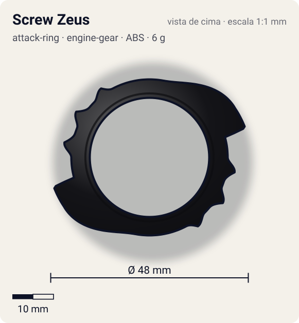
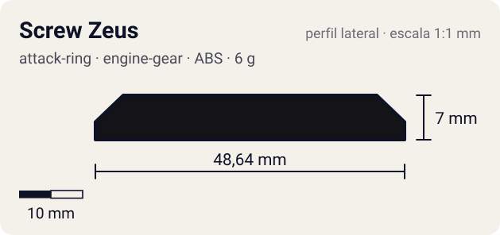

# Screw Zeus (スクリューゼウス)

<!-- auto:inicio (gerado por npm run build:research; não edite este bloco) -->
 

| Medidas e material | |
|---|---|
| Diâmetro | 48 estimado mm |
| Altura / espessura | 7 estimado mm |
| Peso | 6 estimado g |
| Material | ABS (opaco) |
| Estrelas Takara (A / D / S) | 3 / 2 / 1 |
| Usada em | [Zeus](../../../personagens/brooklyn-masefield/beyblades/zeus/) |
<!-- auto:fim -->

| Campo | Valor |
|---|---|
| Id | `attack-ring/screw-zeus` |
| Categoria | Attack Ring |
| Sistema | Engine Gear System |
| Material | ABS |
| Acabamento | opaco |
| Cores (primária / secundária / detalhe) | `#141418` / `#d8401c` / `#f2c230` |

## Beys que usam

- `brooklyn-masefield/zeus` ([ficha](../../../personagens/brooklyn-masefield/beyblades/zeus/README.md))

## Formato

Anel largo (raio interno ~14,5 mm, abraça o Holy Despell) com **2 garras pretas em gancho** em lados opostos, que crescem em arco de ~60° e terminam numa ponta curvada para fora (~24 mm do centro). Atrás de cada garra vem uma faixa de **chamas vermelho-laranja com 3 pontas** curtas (~21 mm), dando uma silhueta de estrela irregular. Detalhes amarelos em losango perto das garras.

Anel externo livre, preto, com 2 grandes garras curvas e uma coroa de chamas vermelhas pontiagudas (adesivo "ZEUS").

## Função em batalha

Defesa: o anel livre gira solto no impacto e dissipa o golpe; as garras dão upper attack (caixa Takara).

## Reação por sentido de rotação

- **Direita (horário visto de cima):** Sentido de fábrica. As garras sobem em rampa e terminam em gancho: levantam o adversário (upper) e, como o anel é livre, quase não transmitem recoil.
- **Esquerda (anti-horário):** As pontas das chamas lideram: smash fraco; o anel livre ainda absorve parte do choque.
- Sentido ótimo: **direita**. Tipo de contato: **upper**, 2 contato(s), recoil 0,25 (0–1, estimado).

## Combos conhecidos

- Wiki (Dragon Saucer): Screw Zeus como Sub-AR travado em Dragon Saucer, Wide Defense, Neo SG (Heavy Metal Core), Defense Grip Base invertida: combo de ataque.

## Medidas, material e stats

| Item | Valor | Fonte |
|---|---|---|
| Diâmetro | 48 mm | estimado (2 × maior raio da `forma`) |
| Altura | 7 mm | estimado |
| Peso | 6 g | estimado |
| Material | ABS | O AR inteiro gira livre em volta do Holy Despell (caixa: アタックリング全体がフリー回転). Também usado como Sub-AR em customizações (wiki, Dragon Saucer). |
| Ataque / Defesa / Stamina | — (não publicados) | — |
| Raio de contato | 24 mm | estimado |

## Forma (parâmetros do gerador de SVG)

Convenção: ângulos em graus, sentido horário visto de cima, 0° = topo; o setor (0 a 180°) se repete 2 vezes. Na rotação **direita** a face em `fim` é a que bate; na **esquerda**, a face em `inicio`. Anel base com raio 19 mm, furo central 14,5 mm, espessura 6 mm.

| início | pico | fim | raio (mm) | borda | altura (mm) | material |
|---|---|---|---|---|---|---|
| 10° | 60° | 75° | 24 | gancho | 7 | ABS/PC |
| 90° | 100° | 108° | 21 | ponta | 5 | ABS/PC |
| 112° | 122° | 130° | 21 | ponta | 5 | ABS/PC |
| 135° | 145° | 152° | 20,5 | ponta | 5 | ABS/PC |

## Observações

Peso não publicado: estimado (anel grande e grosso). Stats: a caixa Takara mostra estrelas, mas não foi possível lê-las com precisão na foto local; deixado null.

## Referências locais

- [referencia/zeus-caixa-verso-pecas.jpg](referencia/zeus-caixa-verso-pecas.jpg) (cópia de `personagens/brooklyn-masefield/beyblades/zeus/pecas/caixa-verso-pecas.jpg`)
- [referencia/zeus-montada.jpg](referencia/zeus-montada.jpg) (cópia de `personagens/brooklyn-masefield/beyblades/zeus/imagem.jpg`)

## Fontes

- https://beyblade.fandom.com/wiki/Zeus
- https://beyblade.fandom.com/wiki/Attack_Ring_-_Dragon_Saucer
- Caixa Takara A-129 (foto local)
