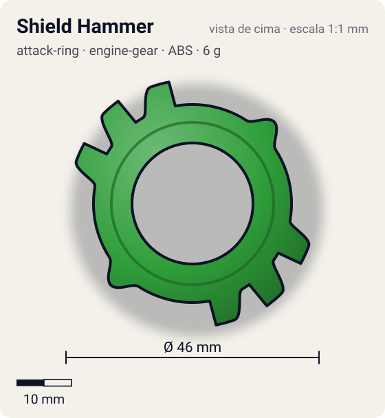
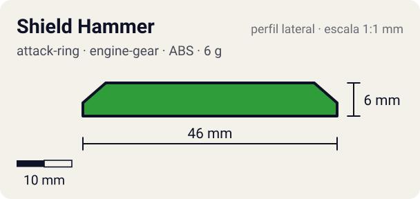

# Shield Hammer

<!-- auto:inicio (gerado por npm run build:research; não edite este bloco) -->
 

| Medidas e material | |
|---|---|
| Diâmetro | 46 estimado mm |
| Altura / espessura | 6 estimado mm |
| Peso | 6 wiki g |
| Material | ABS (opaco) |
| Estrelas Takara (A / D / S) | 2 / 4 / 2 |
| Usada em | [Draciel G](../../../personagens/max-tate/beyblades/draciel-g/) |
<!-- auto:fim -->

| Campo | Valor |
|---|---|
| Id | `attack-ring/shield-hammer` |
| Categoria | Attack Ring |
| Sistema | Engine Gear System |
| Material | ABS |
| Acabamento | opaco |
| Cores (primária / secundária / detalhe) | `#2f9e3a` / `#2457c5` / `#d8262c` |

## Beys que usam

- `max-tate/draciel-g` ([ficha](../../../personagens/max-tate/beyblades/draciel-g/README.md))

## Formato

Simetria 2 (rodada 45° em relação à foto). Duas **cabeças de tartaruga** pequenas e arredondadas (~21 mm, adesivo vermelho "M") opostas; a 90° delas, duas **garras** largas formadas por **3 placas hexagonais** em leque (~22,5–23 mm, adesivos azuis "M DRACIEL"), com triângulos amarelos entre as placas.

2 pequenas cabeças de tartaruga opostas + 2 "garras" opostas, cada uma com 3 hexágonos em losango ligeiramente salientes.

## Função em batalha

Feito para defesa, contorno razoavelmente redondo, mas com algum recoil e sem ataque.

## Reação por sentido de rotação

- **Direita (horário visto de cima):** Placas simétricas: igual nos dois sentidos; as quinas dos hexágonos dão recoil.
- **Esquerda (anti-horário):** Igual.
- Sentido ótimo: **ambos**. Tipo de contato: **defesa**, 6 contato(s), recoil 0,5 (0–1, estimado).

## Combos conhecidos

- Nenhum combo documentado nas fontes.

## Medidas, material e stats

| Item | Valor | Fonte |
|---|---|---|
| Diâmetro | 46 mm | estimado (2 × maior raio da `forma`) |
| Altura | 6 mm | estimado |
| Peso | 6 g | wiki |
| Material | ABS | — |
| Ataque / Defesa / Stamina | 2 / 4 / 2 | Beyblade Wiki, Part Infobox |
| Raio de contato | 23 mm | estimado |

## Forma (parâmetros do gerador de SVG)

Convenção: ângulos em graus, sentido horário visto de cima, 0° = topo; o setor (0 a 180°) se repete 2 vezes. Na rotação **direita** a face em `fim` é a que bate; na **esquerda**, a face em `inicio`. Anel base com raio 18 mm, furo central 11 mm, espessura 6 mm.

| início | pico | fim | raio (mm) | borda | altura (mm) | material |
|---|---|---|---|---|---|---|
| 33° | 45° | 57° | 21 | curva | 6 | ABS/PC |
| 100° | 110° | 120° | 22,5 | reta | 6 | ABS/PC |
| 125° | 135° | 145° | 23 | reta | 6 | ABS/PC |
| 150° | 160° | 170° | 22,5 | reta | 6 | ABS/PC |

## Referências locais

- [referencia/draciel-g-attack-ring.jpg](referencia/draciel-g-attack-ring.jpg) (cópia de `personagens/max-tate/beyblades/draciel-g/pecas/attack-ring.jpg`)

## Fontes

- https://beyblade.fandom.com/wiki/Attack_Ring_-_Shield_Hammer
- https://beyblade.fandom.com/wiki/Draciel_G
