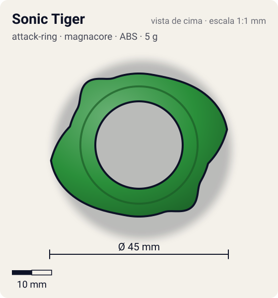
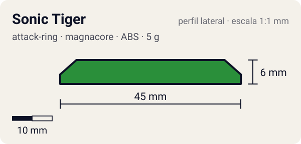

# Sonic Tiger

<!-- auto:inicio (gerado por npm run build:research; não edite este bloco) -->
 

| Medidas e material | |
|---|---|
| Diâmetro | 45 estimado mm |
| Altura / espessura | 6 estimado mm |
| Peso | 5 wiki g |
| Material | ABS (opaco) |
| Estrelas Takara (A / D / S) | 2,5 / 1,5 / 1,5 |
| Usada em | [Driger V](../../../personagens/ray-kon/beyblades/driger-v/) |
<!-- auto:fim -->

| Campo | Valor |
|---|---|
| Id | `attack-ring/sonic-tiger` |
| Categoria | Attack Ring |
| Sistema | Magnacore System |
| Material | ABS |
| Acabamento | opaco |
| Cores (primária / secundária / detalhe) | `#2a8f3a` / `#f2c230` / `#d8262c` |

## Beys que usam

- `ray-kon/driger-v` ([ficha](../../../personagens/ray-kon/beyblades/driger-v/README.md))

## Formato

Simetria 2. Cada lado: uma **asa em lâmina** que sobe em rampa por ~70° até ~22,5 mm e termina numa ponta; atrás, uma **cabeça de tigre** arredondada (~20,5 mm).

2 asas grandes em lâmina + 2 cabeças de tigre (simetria 2).

## Função em batalha

"Ataque para todos os fins": as asas atingem a parte de cima do oponente; bom equilíbrio.

## Reação por sentido de rotação

- **Direita (horário visto de cima):** Sentido de fábrica: as pontas das asas batem alto no adversário.
- **Esquerda (anti-horário):** Lideram as cabeças: contato arredondado, pouco dano.
- Sentido ótimo: **direita**. Tipo de contato: **slope**, 2 contato(s), recoil 0,4 (0–1, estimado).

## Combos conhecidos

- Nenhum combo documentado nas fontes.

## Medidas, material e stats

| Item | Valor | Fonte |
|---|---|---|
| Diâmetro | 45 mm | estimado (2 × maior raio da `forma`) |
| Altura | 6 mm | estimado |
| Peso | 5 g | wiki |
| Material | ABS | — |
| Ataque / Defesa / Stamina | 3 / 2 / 2 | Beyblade Wiki, Part Infobox |
| Raio de contato | 22,5 mm | estimado |

## Forma (parâmetros do gerador de SVG)

Convenção: ângulos em graus, sentido horário visto de cima, 0° = topo; o setor (0 a 180°) se repete 2 vezes. Na rotação **direita** a face em `fim` é a que bate; na **esquerda**, a face em `inicio`. Anel base com raio 18 mm, furo central 11 mm, espessura 6 mm.

| início | pico | fim | raio (mm) | borda | altura (mm) | material |
|---|---|---|---|---|---|---|
| 10° | 80° | 105° | 22,5 | rampa | 6 | ABS/PC |
| 120° | 140° | 160° | 20,5 | curva | 6 | ABS/PC |

## Observações

Cores aproximadas (wiki cita versão verde da Takara).

## Referências locais

- Nenhuma foto local desta peça no repositório.

## Fontes

- https://beyblade.fandom.com/wiki/Attack_Ring_-_Sonic_Tiger
- https://beyblade.fandom.com/wiki/Driger_V
