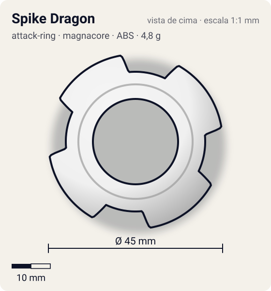
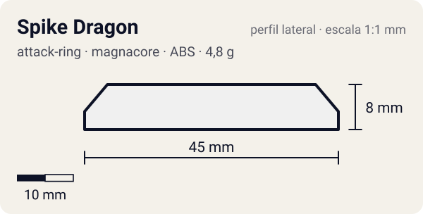

# Spike Dragon

<!-- auto:inicio (gerado por npm run build:research; não edite este bloco) -->
 

| Medidas e material | |
|---|---|
| Diâmetro | 45 estimado mm |
| Altura / espessura | 8 estimado mm |
| Peso | 4,8 wiki g |
| Material | ABS (opaco) |
| Estrelas Takara (A / D / S) | 3 / 1,5 / 1 |
| Usada em | [Dragoon V2 (Dragoon Victory 2)](../../../personagens/tyson-granger/beyblades/dragoon-v2/), [Dragoon V2 High Power Custom](../../../personagens/tyson-granger/beyblades/dragoon-v2-high-power-custom/) |
<!-- auto:fim -->

| Campo | Valor |
|---|---|
| Id | `attack-ring/spike-dragon` |
| Categoria | Attack Ring |
| Sistema | Magnacore System |
| Material | ABS |
| Acabamento | opaco |
| Cores (primária / secundária / detalhe) | `#f0f0f0` / `#2457c5` / `#d8262c` |

## Beys que usam

- `tyson-granger/dragoon-v2` ([ficha](../../../personagens/tyson-granger/beyblades/dragoon-v2/README.md))
- `tyson-granger/dragoon-v2-high-power-custom` ([ficha](../../../personagens/tyson-granger/beyblades/dragoon-v2-high-power-custom/README.md))

## Formato

Simetria 4, grosso. Cada **cabeça de dragão** tem borda curva e lisa (sobrancelha, topo, crista) que sobe por ~55° e termina numa **face plana vertical larga** (~22,5 mm) virada para o sentido anti-horário, marcada por **4 ranhuras verticais**.

4 cabeças de dragão com cristas; as cristas terminam em faces planas, grossas e verticais com 4 ranhuras paralelas.

## Função em batalha

Smash esquerdo devastador (bom para OHKO), com recoil severo.

## Reação por sentido de rotação

- **Direita (horário visto de cima):** Lideram as bordas curvas: muito recoil, sem uso.
- **Esquerda (anti-horário):** Sentido de fábrica: faces planas ranhuradas lideram, smash + spike fortíssimos.
- Sentido ótimo: **esquerda**. Tipo de contato: **spike**, 4 contato(s), recoil 0,75 (0–1, estimado).

## Combos conhecidos

- Nenhum combo documentado nas fontes.

## Medidas, material e stats

| Item | Valor | Fonte |
|---|---|---|
| Diâmetro | 45 mm | estimado (2 × maior raio da `forma`) |
| Altura | 8 mm | estimado |
| Peso | 4,8 g | wiki |
| Material | ABS | AR grosso. |
| Ataque / Defesa / Stamina | 3 / 2 / 1 | Beyblade Wiki, Part Infobox |
| Raio de contato | 22,5 mm | estimado |

## Forma (parâmetros do gerador de SVG)

Convenção: ângulos em graus, sentido horário visto de cima, 0° = topo; o setor (0 a 90°) se repete 4 vezes. Na rotação **direita** a face em `fim` é a que bate; na **esquerda**, a face em `inicio`. Anel base com raio 18 mm, furo central 11 mm, espessura 7 mm.

| início | pico | fim | raio (mm) | borda | altura (mm) | material |
|---|---|---|---|---|---|---|
| 5° | 10° | 65° | 22,5 | reta | 8 | ABS/PC |

## Observações

A Dragoon V2 High Power Custom usa a mesma peça. Cores aproximadas.

## Referências locais

- Nenhuma foto local desta peça no repositório.

## Fontes

- https://beyblade.fandom.com/wiki/Attack_Ring_-_Spike_Dragon
- https://beyblade.fandom.com/wiki/Dragoon_V2
