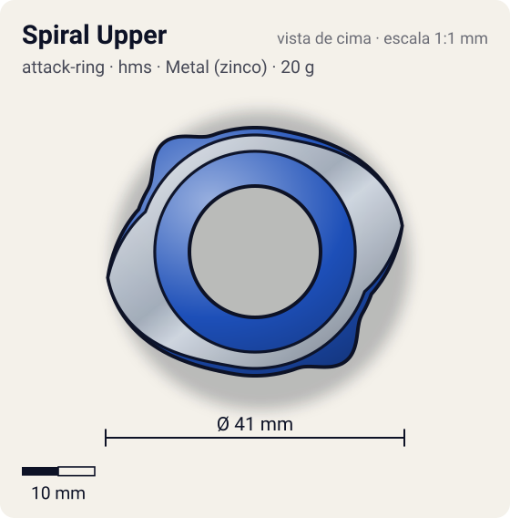
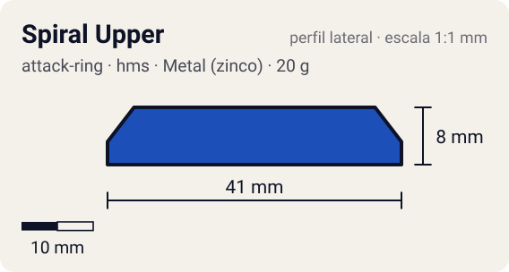

# Spiral Upper (スパイラルアッパー)

<!-- auto:inicio (gerado por npm run build:research; não edite este bloco) -->
 

| Medidas e material | |
|---|---|
| Diâmetro | 41 estimado mm |
| Altura / espessura | 8 estimado mm |
| Peso | 20 wiki g |
| Material | Metal (zinco) + ABS (metalico) |
| Estrelas Takara (A / D / S) | 2 / 2 / 2,5 |
| Usada em | [Dranzer MS](../../../personagens/kai-hiwatari/beyblades/dranzer-ms/) |
<!-- auto:fim -->

| Campo | Valor |
|---|---|
| Id | `attack-ring/spiral-upper` |
| Categoria | Attack Ring |
| Sistema | Hard Metal System (HMS) |
| Material | Metal (zinco) + ABS |
| Acabamento | metalico |
| Cores (primária / secundária / detalhe) | `#1d4fb8` / `#9ea3a8` / `#d8262c` |

## Beys que usam

- `kai-hiwatari/dranzer-ms` ([ficha](../../../personagens/kai-hiwatari/beyblades/dranzer-ms/README.md))

## Formato

Compacto e quase redondo (HMS). A moldura de metal aparece em **2 rampas** opostas que sobem em espiral por ~70° até ~20,5 mm e terminam numa face reta. A capa ABS azul preenche o resto com 2 bossas arredondadas e adesivos.

AR de HMS em duas peças: moldura metálica Left Upper com 2 rampas leves + capa ABS Spiral Upper.

## Função em batalha

Upper moderado na rotação esquerda e smash confiável na direita.

## Reação por sentido de rotação

- **Direita (horário visto de cima):** As faces retas no fim das rampas lideram: smash confiável.
- **Esquerda (anti-horário):** A parte baixa das rampas lidera: upper moderado.
- Sentido ótimo: **ambos**. Tipo de contato: **upper**, 2 contato(s), recoil 0,35 (0–1, estimado).

## Combos conhecidos

- Nenhum combo documentado nas fontes.

## Medidas, material e stats

| Item | Valor | Fonte |
|---|---|---|
| Diâmetro | 41 mm | estimado (2 × maior raio da `forma`) |
| Altura | 8 mm | estimado |
| Peso | 20 g | wiki |
| Material | Metal (zinco) + ABS | Metal Frame "Left Upper" + ABS Caul "Spiral Upper". |
| Ataque / Defesa / Stamina | 2 / 2 / 2,5 | Beyblade Wiki, Part Infobox e tabela da página Dranzer MS |
| Raio de contato | 20,5 mm | estimado |

## Forma (parâmetros do gerador de SVG)

Convenção: ângulos em graus, sentido horário visto de cima, 0° = topo; o setor (0 a 180°) se repete 2 vezes. Na rotação **direita** a face em `fim` é a que bate; na **esquerda**, a face em `inicio`. Anel base com raio 17 mm, furo central 9 mm, espessura 8 mm. `forma.moldura` descreve só a moldura metálica (simetria 2).

| início | pico | fim | raio (mm) | borda | altura (mm) | material |
|---|---|---|---|---|---|---|
| 10° | 80° | 110° | 20,5 | rampa | 7 | metal |
| 120° | 140° | 160° | 19,5 | curva | 8 | ABS/PC |

## Observações

forma.moldura descreve o Metal Frame. Cor da capa aproximada.

## Referências locais

- Nenhuma foto local desta peça no repositório.

## Fontes

- https://beyblade.fandom.com/wiki/Attack_Ring_-_Spiral_Upper
- https://beyblade.fandom.com/wiki/Dranzer_MS
