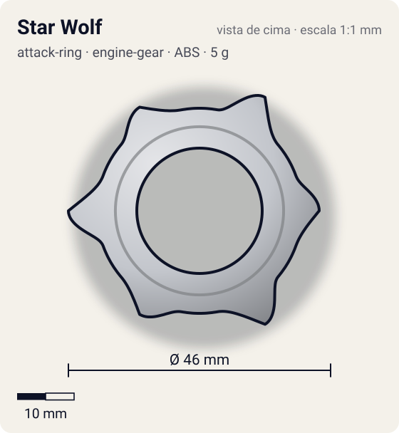
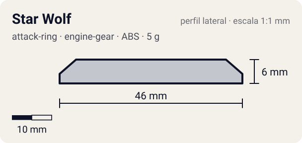

# Star Wolf

<!-- auto:inicio (gerado por npm run build:research; não edite este bloco) -->
 

| Medidas e material | |
|---|---|
| Diâmetro | 46 estimado mm |
| Altura / espessura | 6 estimado mm |
| Peso | 5 wiki g |
| Material | ABS (metalico) |
| Estrelas Takara (A / D / S) | 2 / 1 / 1 |
| Usada em | [Wolborg 4](../../../personagens/tala/beyblades/wolborg-4/) |
<!-- auto:fim -->

| Campo | Valor |
|---|---|
| Id | `attack-ring/star-wolf` |
| Categoria | Attack Ring |
| Sistema | Engine Gear System |
| Material | ABS |
| Acabamento | metalico |
| Cores (primária / secundária / detalhe) | `#c3c6cc` / `#2457c5` / `#d8262c` |

## Beys que usam

- `tala/wolborg-4` ([ficha](../../../personagens/tala/beyblades/wolborg-4/README.md))

## Formato

**Estrela de 6 pontas** prateada. 3 pontas maiores são **cabeças de lobo** (~23 mm) com um entalhe de focinho; alternadas com 3 **triângulos** menores (~21 mm) com adesivo azul "WOLF". Arcos vermelhos/amarelos no anel.

Estrela de 6 pontas: 3 cabeças de lobo (com focinho entalhado) + 3 triângulos menores com parafusos decorativos.

## Função em batalha

Smash moderado nas duas rotações, com recoil sério.

## Reação por sentido de rotação

- **Direita (horário visto de cima):** Pontas simétricas: smash moderado, recoil alto.
- **Esquerda (anti-horário):** Igual.
- Sentido ótimo: **ambos**. Tipo de contato: **smash**, 6 contato(s), recoil 0,65 (0–1, estimado).

## Combos conhecidos

- Wiki: usar só se Cross Griffon, Eight Spiker ou Triple Tiger não estiverem disponíveis.

## Medidas, material e stats

| Item | Valor | Fonte |
|---|---|---|
| Diâmetro | 46 mm | estimado (2 × maior raio da `forma`) |
| Altura | 6 mm | estimado |
| Peso | 5 g | wiki |
| Material | ABS | Plástico com acabamento prateado. |
| Ataque / Defesa / Stamina | 2 / 1 / 1 | Beyblade Wiki, Part Infobox |
| Raio de contato | 23 mm | estimado |

## Forma (parâmetros do gerador de SVG)

Convenção: ângulos em graus, sentido horário visto de cima, 0° = topo; o setor (0 a 120°) se repete 3 vezes. Na rotação **direita** a face em `fim` é a que bate; na **esquerda**, a face em `inicio`. Anel base com raio 18 mm, furo central 11 mm, espessura 6 mm.

| início | pico | fim | raio (mm) | borda | altura (mm) | material |
|---|---|---|---|---|---|---|
| 10° | 30° | 50° | 23 | ponta | 6 | ABS/PC |
| 70° | 90° | 110° | 21 | ponta | 6 | ABS/PC |

## Referências locais

- [referencia/wolborg-4-attack-ring.jpg](referencia/wolborg-4-attack-ring.jpg) (cópia de `personagens/tala/beyblades/wolborg-4/pecas/attack-ring.jpg`)
- [referencia/wolborg-4-topo.jpg](referencia/wolborg-4-topo.jpg) (cópia de `personagens/tala/beyblades/wolborg-4/imagem-topo.jpg`)

## Fontes

- https://beyblade.fandom.com/wiki/Attack_Ring_-_Star_Wolf
- https://beyblade.fandom.com/wiki/Wolborg_4
