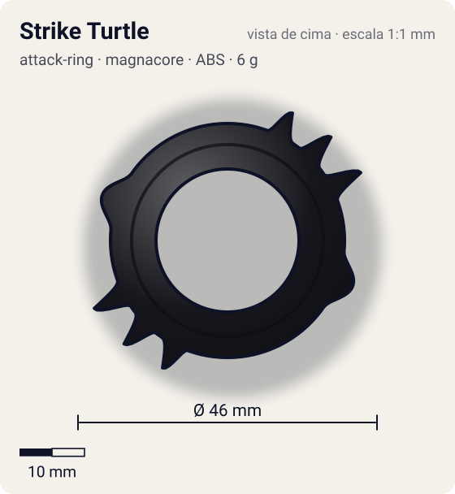
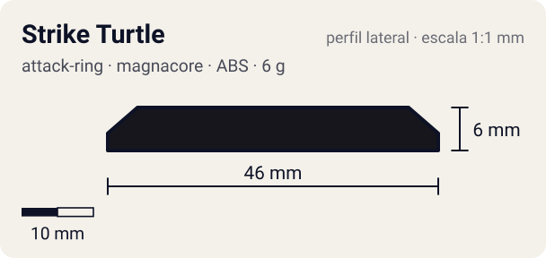

# Strike Turtle

<!-- auto:inicio (gerado por npm run build:research; não edite este bloco) -->
 

| Medidas e material | |
|---|---|
| Diâmetro | 46 estimado mm |
| Altura / espessura | 6 estimado mm |
| Peso | 6 wiki g |
| Material | ABS (opaco) |
| Estrelas Takara (A / D / S) | 2,5 / 2,5 / 2 |
| Usada em | [Draciel V2](../../../personagens/max-tate/beyblades/draciel-v2/) |
<!-- auto:fim -->

| Campo | Valor |
|---|---|
| Id | `attack-ring/strike-turtle` |
| Categoria | Attack Ring |
| Sistema | Magnacore System |
| Material | ABS |
| Acabamento | opaco |
| Cores (primária / secundária / detalhe) | `#16161c` / `#b7d92a` / `#7a3fa0` |

## Beys que usam

- `max-tate/draciel-v2` ([ficha](../../../personagens/max-tate/beyblades/draciel-v2/README.md))

## Formato

Elipse de simetria 2. Em cada lado, um braço largo varre em arco com **3 garras** pequenas e crescentes (~22–23 mm, adesivo amarelo-esverdeado), seguido da **cabeça** arredondada (~20,5 mm). Adesivos roxos/azuis "DRACIEL" e "V2" no anel.

Elíptico, preto, com 3 pequenas garras de cada lado e uma cabeça logo atrás delas.

## Função em batalha

Desempenho médio: garras pouco pronunciadas para smash; grande e com recoil para defesa/stamina.

## Reação por sentido de rotação

- **Direita (horário visto de cima):** Sentido de fábrica: as garras lideram (smash fraco).
- **Esquerda (anti-horário):** Dorso arredondado lidera: pouco efeito.
- Sentido ótimo: **direita**. Tipo de contato: **smash**, 6 contato(s), recoil 0,55 (0–1, estimado).

## Combos conhecidos

- Nenhum combo documentado nas fontes.

## Medidas, material e stats

| Item | Valor | Fonte |
|---|---|---|
| Diâmetro | 46 mm | estimado (2 × maior raio da `forma`) |
| Altura | 6 mm | estimado |
| Peso | 6 g | wiki |
| Material | ABS | Infobox diz 14 g (provável erro); a descrição da peça e a página da Draciel V2 dão 6 g. |
| Ataque / Defesa / Stamina | 3 / 2 / 2 | Beyblade Wiki, Part Infobox |
| Raio de contato | 23 mm | estimado |

## Forma (parâmetros do gerador de SVG)

Convenção: ângulos em graus, sentido horário visto de cima, 0° = topo; o setor (0 a 180°) se repete 2 vezes. Na rotação **direita** a face em `fim` é a que bate; na **esquerda**, a face em `inicio`. Anel base com raio 18 mm, furo central 11 mm, espessura 6 mm.

| início | pico | fim | raio (mm) | borda | altura (mm) | material |
|---|---|---|---|---|---|---|
| 20° | 27° | 34° | 22 | ponta | 6 | ABS/PC |
| 38° | 45° | 52° | 22,5 | ponta | 6 | ABS/PC |
| 56° | 63° | 70° | 23 | ponta | 6 | ABS/PC |
| 95° | 110° | 125° | 20,5 | curva | 6 | ABS/PC |

## Referências locais

- [referencia/draciel-v2-attack-ring.jpg](referencia/draciel-v2-attack-ring.jpg) (cópia de `personagens/max-tate/beyblades/draciel-v2/pecas/attack-ring.jpg`)
- [referencia/draciel-v2-pecas-desmontadas.jpg](referencia/draciel-v2-pecas-desmontadas.jpg) (cópia de `personagens/max-tate/beyblades/draciel-v2/pecas/pecas-desmontadas.jpg`)

## Fontes

- https://beyblade.fandom.com/wiki/Attack_Ring_-_Strike_Turtle
- https://beyblade.fandom.com/wiki/Draciel_V2
