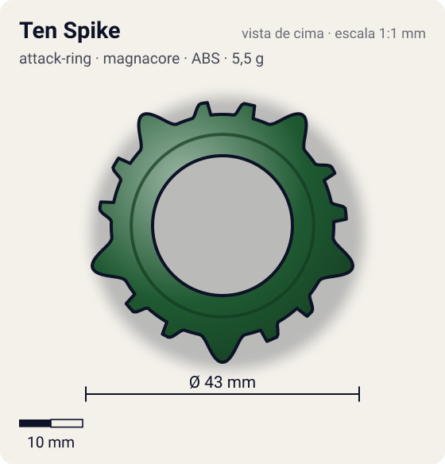
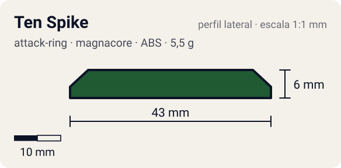

# Ten Spike

<!-- auto:inicio (gerado por npm run build:research; não edite este bloco) -->
 

| Medidas e material | |
|---|---|
| Diâmetro | 43 estimado mm |
| Altura / espessura | 6 estimado mm |
| Peso | 5,5 estimado g |
| Material | ABS (metalico) |
| Estrelas Takara (A / D / S) | 2 / 2 / 2 |
| Usada em | [Draciel V](../../../personagens/max-tate/beyblades/draciel-v/) |
<!-- auto:fim -->

| Campo | Valor |
|---|---|
| Id | `attack-ring/ten-spike` |
| Categoria | Attack Ring |
| Sistema | Magnacore System |
| Material | ABS |
| Acabamento | metalico |
| Cores (primária / secundária / detalhe) | `#1f5a32` / `#3f8f55` / `#c9c9c9` |

## Beys que usam

- `max-tate/draciel-v` ([ficha](../../../personagens/max-tate/beyblades/draciel-v/README.md))

## Formato

Estrela de **5 pontas grandes arredondadas** (~21,5 mm, cabeça de tartaruga). Cada uma tem dos lados uma **pata pequena** de face plana com dedos recortados (~19,5 mm), num total de 15 saliências.

Verde-escuro metálico; 5 projeções grandes (cabeça) ladeadas por pares de projeções menores (patas), formando uma estrela.

## Função em batalha

Muito recoil (projeções planas e desiguais); considerado o pior AR de Draciel.

## Reação por sentido de rotação

- **Direita (horário visto de cima):** Simétrico: igual.
- **Esquerda (anti-horário):** Igual.
- Sentido ótimo: **ambos**. Tipo de contato: **defesa**, 15 contato(s), recoil 0,7 (0–1, estimado).

## Combos conhecidos

- Nenhum combo documentado nas fontes.

## Medidas, material e stats

| Item | Valor | Fonte |
|---|---|---|
| Diâmetro | 43 mm | estimado (2 × maior raio da `forma`) |
| Altura | 6 mm | estimado |
| Peso | 5,5 g | estimado |
| Material | ABS | — |
| Ataque / Defesa / Stamina | 2 / 2 / 2 | Beyblade Wiki, Part Infobox |
| Raio de contato | 21,5 mm | estimado |

## Forma (parâmetros do gerador de SVG)

Convenção: ângulos em graus, sentido horário visto de cima, 0° = topo; o setor (0 a 72°) se repete 5 vezes. Na rotação **direita** a face em `fim` é a que bate; na **esquerda**, a face em `inicio`. Anel base com raio 17,5 mm, furo central 11 mm, espessura 6 mm.

| início | pico | fim | raio (mm) | borda | altura (mm) | material |
|---|---|---|---|---|---|---|
| 6° | 10° | 16° | 19,5 | reta | 6 | ABS/PC |
| 24° | 36° | 48° | 21,5 | curva | 6 | ABS/PC |
| 56° | 62° | 66° | 19,5 | reta | 6 | ABS/PC |

## Observações

Peso não publicado: estimado.

## Referências locais

- [referencia/draciel-v-attack-ring.gif](referencia/draciel-v-attack-ring.gif) (cópia de `personagens/max-tate/beyblades/draciel-v/pecas/attack-ring.gif`)
- [referencia/draciel-v-pecas-desmontadas.jpg](referencia/draciel-v-pecas-desmontadas.jpg) (cópia de `personagens/max-tate/beyblades/draciel-v/pecas/pecas-desmontadas.jpg`)

## Fontes

- https://beyblade.fandom.com/wiki/Attack_Ring_-_Ten_Spike
- https://beyblade.fandom.com/wiki/Draciel_V
