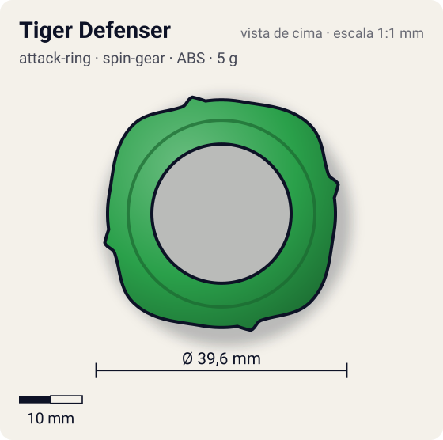
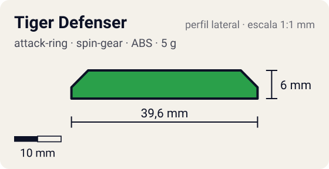

# Tiger Defenser

<!-- auto:inicio (gerado por npm run build:research; não edite este bloco) -->
 

| Medidas e material | |
|---|---|
| Diâmetro | 39,6 estimado mm |
| Altura / espessura | 6 estimado mm |
| Peso | 5 wiki g |
| Material | ABS (opaco) |
| Estrelas Takara (A / D / S) | 1 / 3 / 2 |
| Usada em | [Driger S](../../../personagens/ray-kon/beyblades/driger-s/) |
<!-- auto:fim -->

| Campo | Valor |
|---|---|
| Id | `attack-ring/tiger-defenser` |
| Categoria | Attack Ring |
| Sistema | Spin Gear System |
| Material | ABS |
| Acabamento | opaco |
| Cores (primária / secundária / detalhe) | `#2aa04a` / `#f0f0f0` / `#f2c230` |

## Beys que usam

- `ray-kon/driger-s` ([ficha](../../../personagens/ray-kon/beyblades/driger-s/README.md))

## Formato

Quase um **círculo** (~40 mm). Simetria 4 com **ondulações arredondadas** suaves (~19,8 mm) e, entre elas, **mini-rampas** baixas. Nenhuma face reta.

Anel pequeno e quase redondo, com pontas arredondadas (garras curtas) e pequenas rampas de upper.

## Função em batalha

Pouco recoil: ótima stamina e defesa; algum ataque leve. Muito usado em compactos.

## Reação por sentido de rotação

- **Direita (horário visto de cima):** Redondo: pouco recoil; as mini-rampas dão um upper leve.
- **Esquerda (anti-horário):** Igual, pouco recoil. Para survival esquerda a wiki prefere War Lion.
- Sentido ótimo: **ambos**. Tipo de contato: **survival**, 4 contato(s), recoil 0,15 (0–1, estimado).

## Combos conhecidos

- Wiki: Tiger Defenser, Wide Survivor, Left SG (Bearing), eixo Bearing Base, Defense Grip Base 2: survival/zombie.
- Wiki: Tiger Defenser, Ten Heavy, Neo Right SG (Heavy Metal Core), Metal Change Base: compacto.

## Medidas, material e stats

| Item | Valor | Fonte |
|---|---|---|
| Diâmetro | 39,6 mm | estimado (2 × maior raio da `forma`) |
| Altura | 6 mm | estimado |
| Peso | 5 g | wiki |
| Material | ABS | A Hasbro também o incluiu recolorido na Jumping Base. |
| Ataque / Defesa / Stamina | 1 / 3 / 2 | Beyblade Wiki, Part Infobox |
| Raio de contato | 19,8 mm | estimado |

## Forma (parâmetros do gerador de SVG)

Convenção: ângulos em graus, sentido horário visto de cima, 0° = topo; o setor (0 a 90°) se repete 4 vezes. Na rotação **direita** a face em `fim` é a que bate; na **esquerda**, a face em `inicio`. Anel base com raio 18 mm, furo central 11 mm, espessura 6 mm.

| início | pico | fim | raio (mm) | borda | altura (mm) | material |
|---|---|---|---|---|---|---|
| 10° | 45° | 70° | 19,8 | curva | 6 | ABS/PC |
| 70° | 76° | 82° | 19 | rampa | 5 | ABS/PC |

## Observações

Cores aproximadas (sem foto local).

## Referências locais

- Nenhuma foto local desta peça no repositório.

## Fontes

- https://beyblade.fandom.com/wiki/Attack_Ring_-_Tiger_Defenser
- https://beyblade.fandom.com/wiki/Driger_S
