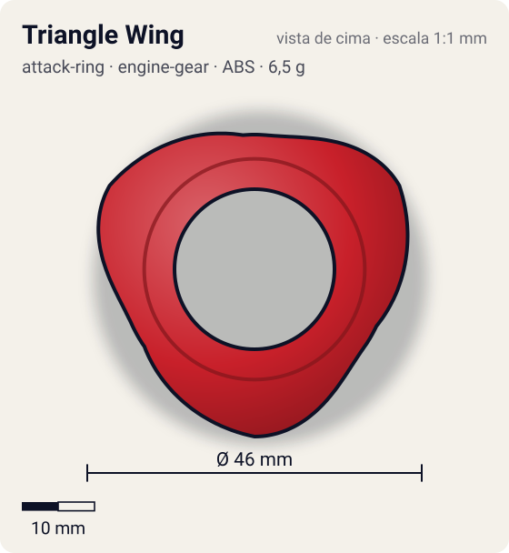
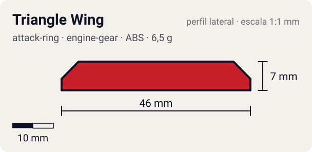

# Triangle Wing

<!-- auto:inicio (gerado por npm run build:research; não edite este bloco) -->
 

| Medidas e material | |
|---|---|
| Diâmetro | 46 estimado mm |
| Altura / espessura | 7 estimado mm |
| Peso | 6,5 estimado g |
| Material | ABS (opaco) |
| Estrelas Takara (A / D / S) | 4 / 1 / 2 |
| Usada em | [Dranzer GT](../../../personagens/kai-hiwatari/beyblades/dranzer-gt/) |
<!-- auto:fim -->

| Campo | Valor |
|---|---|
| Id | `attack-ring/triangle-wing` |
| Categoria | Attack Ring |
| Sistema | Engine Gear System |
| Material | ABS |
| Acabamento | opaco |
| Cores (primária / secundária / detalhe) | `#c8202a` / `#f2c230` / `#1a1a1a` |

## Beys que usam

- `kai-hiwatari/dranzer-gt` ([ficha](../../../personagens/kai-hiwatari/beyblades/dranzer-gt/README.md))

## Formato

Silhueta quase **triangular arredondada**: 3 asas largas, cada uma com rampa que sobe dos dois lados até um pico central (~23 mm), formando um telhado simétrico. Sem ganchos nem faces retas; as bordas descem suaves para o anel.

Parecido com o Upper Dragoon (Master Dragoon), porém simétrico: rampas que funcionam nos dois sentidos.

## Função em batalha

Upper attack nas duas rotações; um dos melhores ARs de upper em rotação esquerda.

## Reação por sentido de rotação

- **Direita (horário visto de cima):** Rampa simétrica: upper bom, um pouco abaixo do Upper Dragoon nesse sentido.
- **Esquerda (anti-horário):** Mesma rampa: upper bom (um dos melhores para esquerda).
- Sentido ótimo: **ambos**. Tipo de contato: **upper**, 3 contato(s), recoil 0,35 (0–1, estimado).

## Combos conhecidos

- Wiki (Upper Dragoon/Triple Tiger): Triangle Wing é citado como um dos melhores ARs de upper puro, nas duas rotações.

## Medidas, material e stats

| Item | Valor | Fonte |
|---|---|---|
| Diâmetro | 46 mm | estimado (2 × maior raio da `forma`) |
| Altura | 7 mm | estimado |
| Peso | 6,5 g | estimado |
| Material | ABS | — |
| Ataque / Defesa / Stamina | 4 / 1 / 2 | Beyblade Wiki, Part Infobox |
| Raio de contato | 23 mm | estimado |

## Forma (parâmetros do gerador de SVG)

Convenção: ângulos em graus, sentido horário visto de cima, 0° = topo; o setor (0 a 120°) se repete 3 vezes. Na rotação **direita** a face em `fim` é a que bate; na **esquerda**, a face em `inicio`. Anel base com raio 18,5 mm, furo central 11 mm, espessura 6 mm.

| início | pico | fim | raio (mm) | borda | altura (mm) | material |
|---|---|---|---|---|---|---|
| 5° | 60° | 115° | 23 | rampa | 7 | ABS/PC |

## Observações

Peso não publicado: estimado. Contagem de 3 asas estimada pelo nome e pela semelhança com Triple Wing; cores aproximadas.

## Referências locais

- Nenhuma foto local desta peça no repositório.

## Fontes

- https://beyblade.fandom.com/wiki/Attack_Ring_-_Triangle_Wing
- https://beyblade.fandom.com/wiki/Dranzer_GT
