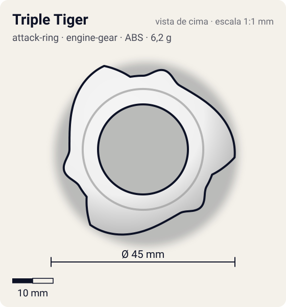
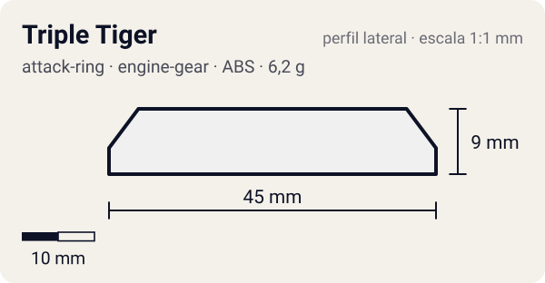

# Triple Tiger

<!-- auto:inicio (gerado por npm run build:research; não edite este bloco) -->
 

| Medidas e material | |
|---|---|
| Diâmetro | 45 estimado mm |
| Altura / espessura | 9 estimado mm |
| Peso | 6,2 wiki g |
| Material | ABS (opaco) |
| Estrelas Takara (A / D / S) | 3 / 1 / 1 |
| Usada em | [Driger G](../../../personagens/ray-kon/beyblades/driger-g/) |
<!-- auto:fim -->

| Campo | Valor |
|---|---|
| Id | `attack-ring/triple-tiger` |
| Categoria | Attack Ring |
| Sistema | Engine Gear System |
| Material | ABS |
| Acabamento | opaco |
| Cores (primária / secundária / detalhe) | `#f0f0f0` / `#2aa84a` / `#d8262c` |

## Beys que usam

- `ray-kon/driger-g` ([ficha](../../../personagens/ray-kon/beyblades/driger-g/README.md))

## Formato

Simetria 3. Cada setor: **cabeça de tigre** arredondada (~20 mm) e, atrás dela, uma **rampa longa** (~65°) que sobe em degraus e termina numa **face vertical alta** (~22,5 mm, desce até o nível do WD). Silhueta de cata-vento de 3 pás.

3 cabeças de tigre seguidas de seções em rampa que descem até a base do WD e terminam em contatos verticais altos.

## Função em batalha

Híbrido de smash e upper de nível top em rotação direita; pouco recoil; protege contra attackers altos.

## Reação por sentido de rotação

- **Direita (horário visto de cima):** As faces verticais lideram com ótimo ângulo: smash forte e upper efetivo, recoil mínimo.
- **Esquerda (anti-horário):** Lideram a borda plana do topo da rampa e um pequeno force smash: muito recoil.
- Sentido ótimo: **direita**. Tipo de contato: **smash**, 3 contato(s), recoil 0,25 (0–1, estimado).

## Combos conhecidos

- Wiki: Triple Tiger, Ten Heavy, Neo Right SG (Heavy Metal Core), Storm Grip Base: upper.
- Wiki: funciona bem com bases altas (Customize Grip Base) porque o contato fica abaixo do nível do AR.

## Medidas, material e stats

| Item | Valor | Fonte |
|---|---|---|
| Diâmetro | 45 mm | estimado (2 × maior raio da `forma`) |
| Altura | 9 mm | estimado |
| Peso | 6,2 g | wiki |
| Material | ABS | As rampas descem até a base do Weight Disk. |
| Ataque / Defesa / Stamina | 3 / 1 / 1 | Beyblade Wiki, Part Infobox |
| Raio de contato | 22,5 mm | estimado |

## Forma (parâmetros do gerador de SVG)

Convenção: ângulos em graus, sentido horário visto de cima, 0° = topo; o setor (0 a 120°) se repete 3 vezes. Na rotação **direita** a face em `fim` é a que bate; na **esquerda**, a face em `inicio`. Anel base com raio 18 mm, furo central 11 mm, espessura 6 mm.

| início | pico | fim | raio (mm) | borda | altura (mm) | material |
|---|---|---|---|---|---|---|
| 0° | 15° | 30° | 20 | curva | 7 | ABS/PC |
| 30° | 95° | 110° | 22,5 | rampa | 9 | ABS/PC |

## Observações

Cores aproximadas (sem foto local).

## Referências locais

- Nenhuma foto local desta peça no repositório.

## Fontes

- https://beyblade.fandom.com/wiki/Attack_Ring_-_Triple_Tiger
- https://beyblade.fandom.com/wiki/Driger_G
