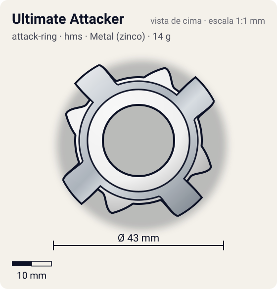
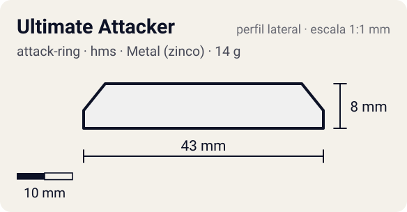

# Ultimate Attacker

<!-- auto:inicio (gerado por npm run build:research; não edite este bloco) -->
 

| Medidas e material | |
|---|---|
| Diâmetro | 43 estimado mm |
| Altura / espessura | 8 estimado mm |
| Peso | 14 wiki g |
| Material | Metal (zinco) + ABS (metalico) |
| Estrelas Takara (A / D / S) | 4,5 / 2,5 / 1 |
| Usada em | [Dragoon MS Ultimate Version](../../../personagens/tyson-granger/beyblades/dragoon-ms-ultimate-version/) |
<!-- auto:fim -->

| Campo | Valor |
|---|---|
| Id | `attack-ring/ultimate-attacker` |
| Categoria | Attack Ring |
| Sistema | Hard Metal System (HMS) |
| Material | Metal (zinco) + ABS |
| Acabamento | metalico |
| Cores (primária / secundária / detalhe) | `#f0f0f0` / `#c9a227` / `#2457c5` |

## Beys que usam

- `tyson-granger/dragoon-ms-ultimate-version` ([ficha](../../../personagens/tyson-granger/beyblades/dragoon-ms-ultimate-version/README.md))

## Formato

Como o Metal Attacker, mas as **pontas metálicas** têm face reta virada para o sentido anti-horário (~21,5 mm) com pequenas saliências que concentram o impacto ("Left Spike").

Capa "Cross Wings" (igual à do Metal Attacker) com nova moldura "Left Spike": 4 cabeças de dragão e 4 pontas de ataque com pequenas protuberâncias.

## Função em batalha

Smash confiável, um pouco melhor que o Metal Attacker; depois superado.

## Reação por sentido de rotação

- **Direita (horário visto de cima):** Lideram as costas das pontas: smash fraco.
- **Esquerda (anti-horário):** Faces das pontas lideram: smash/spike.
- Sentido ótimo: **esquerda**. Tipo de contato: **smash**, 4 contato(s), recoil 0,4 (0–1, estimado).

## Combos conhecidos

- Nenhum combo documentado nas fontes.

## Medidas, material e stats

| Item | Valor | Fonte |
|---|---|---|
| Diâmetro | 43 mm | estimado (2 × maior raio da `forma`) |
| Altura | 8 mm | estimado |
| Peso | 14 g | wiki |
| Material | Metal (zinco) + ABS | Mesma ABS Caul "Cross Wings" do Metal Attacker + Metal Frame "Left Spike". |
| Ataque / Defesa / Stamina | — (não publicados) | — |
| Raio de contato | 21,5 mm | estimado |

## Forma (parâmetros do gerador de SVG)

Convenção: ângulos em graus, sentido horário visto de cima, 0° = topo; o setor (0 a 90°) se repete 4 vezes. Na rotação **direita** a face em `fim` é a que bate; na **esquerda**, a face em `inicio`. Anel base com raio 16 mm, furo central 9 mm, espessura 7 mm. `forma.moldura` descreve só a moldura metálica (simetria 4).

| início | pico | fim | raio (mm) | borda | altura (mm) | material |
|---|---|---|---|---|---|---|
| 20° | 28° | 50° | 21,5 | reta | 8 | metal |
| 55° | 70° | 85° | 19,5 | rampa | 7 | ABS/PC |

## Observações

Cor da moldura (dourado) e da capa aproximadas.

## Referências locais

- Nenhuma foto local desta peça no repositório.

## Fontes

- https://beyblade.fandom.com/wiki/Attack_Ring_-_Ultimate_Attacker
- https://beyblade.fandom.com/wiki/Dragoon_MS_Ultimate_Version
