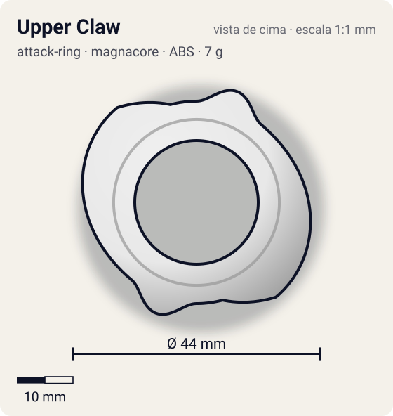
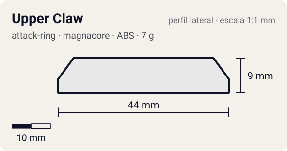

# Upper Claw

<!-- auto:inicio (gerado por npm run build:research; não edite este bloco) -->
 

| Medidas e material | |
|---|---|
| Diâmetro | 44 estimado mm |
| Altura / espessura | 9 estimado mm |
| Peso | 7 wiki g |
| Material | ABS (opaco) |
| Estrelas Takara (A / D / S) | 3 / 1 / 2 |
| Usada em | [Driger V2](../../../personagens/ray-kon/beyblades/driger-v2/) |
<!-- auto:fim -->

| Campo | Valor |
|---|---|
| Id | `attack-ring/upper-claw` |
| Categoria | Attack Ring |
| Sistema | Magnacore System |
| Material | ABS |
| Acabamento | opaco |
| Cores (primária / secundária / detalhe) | `#e8e8e8` / `#2aa84a` / `#1a1a1a` |

## Beys que usam

- `ray-kon/driger-v2` ([ficha](../../../personagens/ray-kon/beyblades/driger-v2/README.md))

## Formato

Simetria 2. Cada lado: uma **cabeça de tigre** grande (~21 mm) e, atrás dela, uma **rampa muito longa** (~125°) que desce até o nível do WD, com **2 quebras de ângulo** no caminho, terminando numa ponta (~22 mm).

2 cabeças de tigre seguidas de rampas longas que descem até o nível do WD; as rampas mudam de ângulo em 2 pontos.

## Função em batalha

Upper attack + "upward smash" em rotação direita; quase sempre usado com o Upper Attack SP.

## Reação por sentido de rotação

- **Direita (horário visto de cima):** As rampas lideram: upper (levanta o oponente); as quebras de ângulo dão upward smash.
- **Esquerda (anti-horário):** As cabeças lideram: algum smash, sem upper.
- Sentido ótimo: **direita**. Tipo de contato: **upper**, 2 contato(s), recoil 0,35 (0–1, estimado).

## Combos conhecidos

- Wiki: Upper Claw, Ten Heavy, Neo Right SG (Heavy Metal Core), Upper Attack SP, Customize Grip Base: upper.

## Medidas, material e stats

| Item | Valor | Fonte |
|---|---|---|
| Diâmetro | 44 mm | estimado (2 × maior raio da `forma`) |
| Altura | 9 mm | estimado |
| Peso | 7 g | wiki |
| Material | ABS | Feito para trabalhar com o Upper Attack SP. |
| Ataque / Defesa / Stamina | 3 / 1 / 2 | Beyblade Wiki, Part Infobox |
| Raio de contato | 22 mm | estimado |

## Forma (parâmetros do gerador de SVG)

Convenção: ângulos em graus, sentido horário visto de cima, 0° = topo; o setor (0 a 180°) se repete 2 vezes. Na rotação **direita** a face em `fim` é a que bate; na **esquerda**, a face em `inicio`. Anel base com raio 18 mm, furo central 11 mm, espessura 6 mm.

| início | pico | fim | raio (mm) | borda | altura (mm) | material |
|---|---|---|---|---|---|---|
| 0° | 20° | 40° | 21 | curva | 7 | ABS/PC |
| 40° | 140° | 165° | 22 | rampa | 9 | ABS/PC |

## Observações

Cores aproximadas (sem foto local).

## Referências locais

- Nenhuma foto local desta peça no repositório.

## Fontes

- https://beyblade.fandom.com/wiki/Attack_Ring_-_Upper_Claw
- https://beyblade.fandom.com/wiki/Driger_V2
