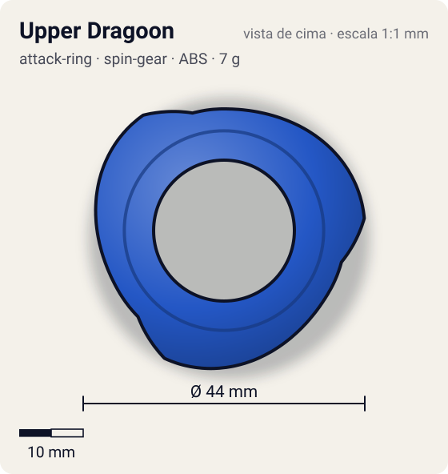
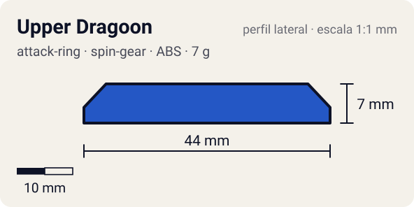

# Upper Dragoon (アッパードラグーン)

<!-- auto:inicio (gerado por npm run build:research; não edite este bloco) -->
 

| Medidas e material | |
|---|---|
| Diâmetro | 44 estimado mm |
| Altura / espessura | 7 estimado mm |
| Peso | 7 wiki g |
| Material | ABS (opaco) |
| Estrelas Takara (A / D / S) | 3 / 1 / 1,5 |
| Usada em | [Master Dragoon (genérica, uso temporário)](../../../personagens/tyson-granger/beyblades/master-dragoon/) |
<!-- auto:fim -->

| Campo | Valor |
|---|---|
| Id | `attack-ring/upper-dragoon` |
| Categoria | Attack Ring |
| Sistema | Spin Gear System |
| Material | ABS |
| Acabamento | opaco |
| Cores (primária / secundária / detalhe) | `#2457c5` / `#f0f0f0` / `#f2c230` |

## Beys que usam

- `tyson-granger/master-dragoon` ([ficha](../../../personagens/tyson-granger/beyblades/master-dragoon/README.md))

## Formato

Contorno **quase redondo**. **Rampas longas** (~85°) que sobem suavemente até ~22 mm e caem logo depois (assimétricas, mais longas para a direita).

Rampas longas que sobem para levantar o adversário (~15° na rotação direita). Quase perfeitamente redondo e um dos ARs mais pesados.

## Função em batalha

Melhor AR de upper da rotação direita e segundo melhor da esquerda.

## Reação por sentido de rotação

- **Direita (horário visto de cima):** Rampas longas de ~15° lideram: upper forte.
- **Esquerda (anti-horário):** Lado curto das rampas: upper bom, abaixo do Triangle Wing.
- Sentido ótimo: **ambos**. Tipo de contato: **upper**, 3 contato(s), recoil 0,25 (0–1, estimado).

## Combos conhecidos

- Wiki: Upper Dragoon, Ten Heavy, Neo SG (Heavy Metal Core), Storm Grip Base: upper.
- Wiki: Upper Dragoon, Wide Defense, Right SG (Bearing), Defense Ring, Customize Grip Base: upper "de centro".
- Wiki: Upper Dragoon, Wide Defense, Neo Right SG (Heavy Metal Core), SG Metal Ball Base: defesa.

## Medidas, material e stats

| Item | Valor | Fonte |
|---|---|---|
| Diâmetro | 44 mm | estimado (2 × maior raio da `forma`) |
| Altura | 7 mm | estimado |
| Peso | 7 g | wiki |
| Material | ABS | Também da Kid Dragoon. |
| Ataque / Defesa / Stamina | — (não publicados) | — |
| Raio de contato | 22 mm | estimado |

## Forma (parâmetros do gerador de SVG)

Convenção: ângulos em graus, sentido horário visto de cima, 0° = topo; o setor (0 a 120°) se repete 3 vezes. Na rotação **direita** a face em `fim` é a que bate; na **esquerda**, a face em `inicio`. Anel base com raio 19 mm, furo central 11 mm, espessura 6 mm.

| início | pico | fim | raio (mm) | borda | altura (mm) | material |
|---|---|---|---|---|---|---|
| 0° | 85° | 105° | 22 | rampa | 7 | ABS/PC |

## Observações

Contagem de rampas (3) e cores estimadas (sem foto local).

## Referências locais

- Nenhuma foto local desta peça no repositório.

## Fontes

- https://beyblade.fandom.com/wiki/Attack_Ring_-_Upper_Dragoon
- https://beyblade.fandom.com/wiki/Master_Dragoon
