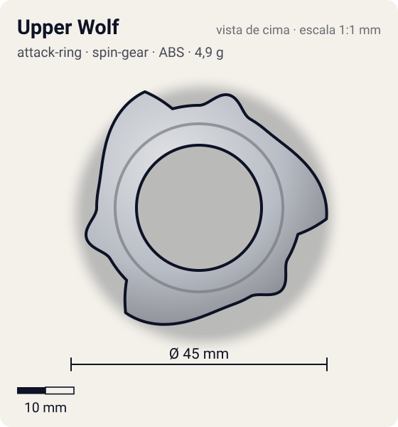
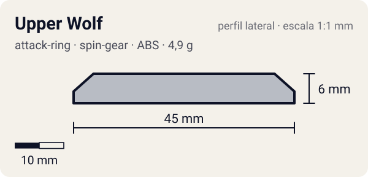

# Upper Wolf

<!-- auto:inicio (gerado por npm run build:research; não edite este bloco) -->
 

| Medidas e material | |
|---|---|
| Diâmetro | 45 estimado mm |
| Altura / espessura | 6 estimado mm |
| Peso | 4,9 wiki g |
| Material | ABS (metalico) |
| Estrelas Takara (A / D / S) | 3 / 1 / 1 |
| Usada em | [Wolborg 2](../../../personagens/tala/beyblades/wolborg-2/) |
<!-- auto:fim -->

| Campo | Valor |
|---|---|
| Id | `attack-ring/upper-wolf` |
| Categoria | Attack Ring |
| Sistema | Spin Gear System |
| Material | ABS |
| Acabamento | metalico |
| Cores (primária / secundária / detalhe) | `#b8bcc4` / `#d8262c` / `#1a1a1a` |

## Beys que usam

- `tala/wolborg-2` ([ficha](../../../personagens/tala/beyblades/wolborg-2/README.md))

## Formato

Simetria 3, prateado. Cada setor: **cabeça de lobo** (~20,5 mm) e uma **projeção em rampa** curta que termina numa ponta virada levemente para fora (~22,5 mm), com detalhe vermelho. Silhueta de 3 lâminas curvas.

3 cabeças de lobo com projeções inclinadas, espaçadas como as do Triple Wing.

## Função em batalha

Smash fraco e muito recoil (contatos apontados para fora); rampas curtas demais para upper.

## Reação por sentido de rotação

- **Direita (horário visto de cima):** Sentido de fábrica: as pontas batem, mas o ângulo para fora gera recoil.
- **Esquerda (anti-horário):** Pequenas faces triangulares lideram: ineficaz.
- Sentido ótimo: **direita**. Tipo de contato: **smash**, 3 contato(s), recoil 0,6 (0–1, estimado).

## Combos conhecidos

- Nenhum combo documentado nas fontes.

## Medidas, material e stats

| Item | Valor | Fonte |
|---|---|---|
| Diâmetro | 45 mm | estimado (2 × maior raio da `forma`) |
| Altura | 6 mm | estimado |
| Peso | 4,9 g | wiki |
| Material | ABS | 4,9 g (molde 1, Takara) / 5,2 g (molde 2, Hasbro reforçado). |
| Ataque / Defesa / Stamina | — (não publicados) | — |
| Raio de contato | 22,5 mm | estimado |

## Forma (parâmetros do gerador de SVG)

Convenção: ângulos em graus, sentido horário visto de cima, 0° = topo; o setor (0 a 120°) se repete 3 vezes. Na rotação **direita** a face em `fim` é a que bate; na **esquerda**, a face em `inicio`. Anel base com raio 18 mm, furo central 11 mm, espessura 6 mm.

| início | pico | fim | raio (mm) | borda | altura (mm) | material |
|---|---|---|---|---|---|---|
| 0° | 15° | 30° | 20,5 | curva | 6 | ABS/PC |
| 40° | 95° | 105° | 22,5 | rampa | 6 | ABS/PC |

## Observações

Cor prata conferida na foto local (pecas-separadas).

## Referências locais

- [referencia/wolborg-2-pecas-separadas.jpg](referencia/wolborg-2-pecas-separadas.jpg) (cópia de `personagens/tala/beyblades/wolborg-2/pecas/pecas-separadas.jpg`)

## Fontes

- https://beyblade.fandom.com/wiki/Attack_Ring_-_Upper_Wolf
- https://beyblade.fandom.com/wiki/Wolborg_2
