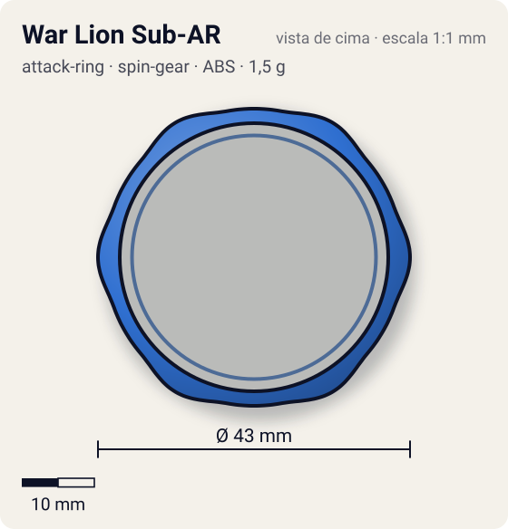
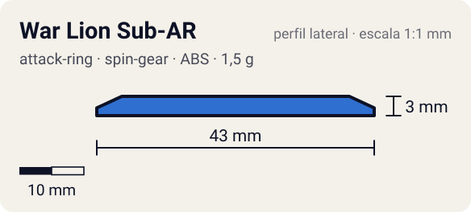

# War Lion Sub-AR

<!-- auto:inicio (gerado por npm run build:research; não edite este bloco) -->
 

| Medidas e material | |
|---|---|
| Diâmetro | 43 estimado mm |
| Altura / espessura | 3 estimado mm |
| Peso | 1,5 estimado g |
| Material | ABS (opaco) |
| Estrelas Takara (A / D / S) | — |
| Usada em | [Galeon](../../../personagens/lee/beyblades/galeon/) |
<!-- auto:fim -->

| Campo | Valor |
|---|---|
| Id | `attack-ring/war-lion-sub-ar` |
| Categoria | Attack Ring |
| Sistema | Spin Gear System |
| Material | ABS |
| Acabamento | opaco |
| Cores (primária / secundária / detalhe) | `#2f6fd0` / `#1d1d24` / `#f2c230` |

## Beys que usam

- `lee/galeon` ([ficha](../../../personagens/lee/beyblades/galeon/README.md))

## Formato

Aro fino (raio ~20,5 mm) com **6 bossas arredondadas** baixas; fica logo para fora do War Lion, por isso é ele que toca primeiro no adversário.

Anel fino livre em volta do War Lion, com 6 ondulações suaves.

## Função em batalha

Recebe o golpe e gira solto, dissipando o impacto.

## Reação por sentido de rotação

- **Direita (horário visto de cima):** Livre: sem sentido.
- **Esquerda (anti-horário):** Livre: sem sentido.
- Sentido ótimo: **ambos**. Tipo de contato: **survival**, 6 contato(s), recoil 0,1 (0–1, estimado).

## Combos conhecidos

- Nenhum combo documentado nas fontes.

## Medidas, material e stats

| Item | Valor | Fonte |
|---|---|---|
| Diâmetro | 43 mm | estimado (2 × maior raio da `forma`) |
| Altura | 3 mm | estimado |
| Peso | 1,5 g | estimado |
| Material | ABS | Sub-Attack Ring livre; frágil. |
| Ataque / Defesa / Stamina | — (não publicados) | — |
| Raio de contato | 21,5 mm | estimado |

## Forma (parâmetros do gerador de SVG)

Convenção: ângulos em graus, sentido horário visto de cima, 0° = topo; o setor (0 a 60°) se repete 6 vezes. Na rotação **direita** a face em `fim` é a que bate; na **esquerda**, a face em `inicio`. Anel base com raio 20,5 mm, furo central 18,5 mm, espessura 3 mm.

| início | pico | fim | raio (mm) | borda | altura (mm) | material |
|---|---|---|---|---|---|---|
| 10° | 30° | 50° | 21,5 | curva | 3 | ABS/PC |

## Observações

Forma e medidas estimadas (sem foto local; galeria da wiki tem "Galeon6.jpg").

## Referências locais

- Nenhuma foto local desta peça no repositório.

## Fontes

- https://beyblade.fandom.com/wiki/Attack_Ring_-_War_Lion
- https://beyblade.fandom.com/wiki/Galeon
- https://beyblade.fandom.com/wiki/Sub-Attack_Rings
