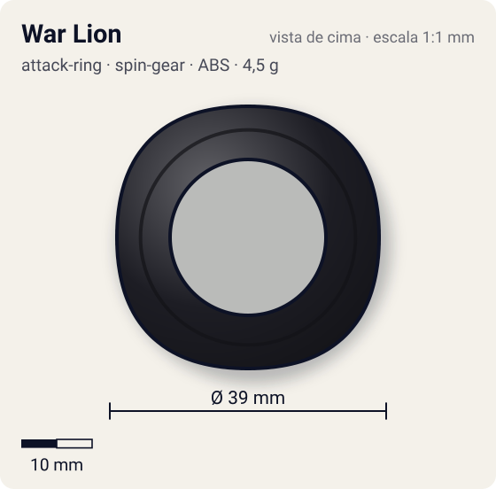
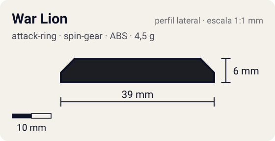

# War Lion

<!-- auto:inicio (gerado por npm run build:research; não edite este bloco) -->
 

| Medidas e material | |
|---|---|
| Diâmetro | 39 estimado mm |
| Altura / espessura | 6 estimado mm |
| Peso | 4,5 estimado g |
| Material | ABS (opaco) |
| Estrelas Takara (A / D / S) | 2,5 / 2,5 / 1 |
| Usada em | [Galeon](../../../personagens/lee/beyblades/galeon/) |
<!-- auto:fim -->

| Campo | Valor |
|---|---|
| Id | `attack-ring/war-lion` |
| Categoria | Attack Ring |
| Sistema | Spin Gear System |
| Material | ABS |
| Acabamento | opaco |
| Cores (primária / secundária / detalhe) | `#1d1d24` / `#2f6fd0` / `#f2c230` |

## Beys que usam

- `lee/galeon` ([ficha](../../../personagens/lee/beyblades/galeon/README.md))

## Formato

Quase um **círculo** (raio ~18,5–19,5 mm) com 4 ondulações muito suaves (juba de leão estilizada). Sem pontas. O Sub-AR livre fica em volta/embaixo, um pouco maior.

AR pequeno e quase perfeitamente redondo, com Sub-AR livre que recebe os golpes.

## Função em batalha

Defesa e sobrevivência excelentes: o Sub-AR leva o golpe e o resto da bey segue girando.

## Reação por sentido de rotação

- **Direita (horário visto de cima):** Redondo: comportamento igual; pouco recoil.
- **Esquerda (anti-horário):** Igual. A wiki recomenda para survival de rotação esquerda.
- Sentido ótimo: **ambos**. Tipo de contato: **defesa**, 4 contato(s), recoil 0,15 (0–1, estimado).

## Combos conhecidos

- Wiki (Tiger Defenser): War Lion é melhor que Tiger Defenser para survival de rotação esquerda.
- Wiki (Driger V2): War Lion, Ten Heavy, Customize Change Base: compacto.

## Medidas, material e stats

| Item | Valor | Fonte |
|---|---|---|
| Diâmetro | 39 mm | estimado (2 × maior raio da `forma`) |
| Altura | 6 mm | estimado |
| Peso | 4,5 g | estimado |
| Material | ABS | Wiki: 6 g com o Sub-AR; aqui 4,5 g (AR) + 1,5 g (Sub-AR), divisão estimada. Quebra fácil. |
| Ataque / Defesa / Stamina | 1 / 3 / 2 | Beyblade Wiki, Part Infobox |
| Raio de contato | 19,5 mm | estimado |

## Forma (parâmetros do gerador de SVG)

Convenção: ângulos em graus, sentido horário visto de cima, 0° = topo; o setor (0 a 90°) se repete 4 vezes. Na rotação **direita** a face em `fim` é a que bate; na **esquerda**, a face em `inicio`. Anel base com raio 18,5 mm, furo central 11 mm, espessura 6 mm.

| início | pico | fim | raio (mm) | borda | altura (mm) | material |
|---|---|---|---|---|---|---|
| 0° | 45° | 90° | 19,5 | curva | 6 | ABS/PC |

## Observações

Cores aproximadas (sem foto local). Decisão: Sub-AR em ficha separada.

## Referências locais

- Nenhuma foto local desta peça no repositório.

## Fontes

- https://beyblade.fandom.com/wiki/Attack_Ring_-_War_Lion
- https://beyblade.fandom.com/wiki/Galeon
