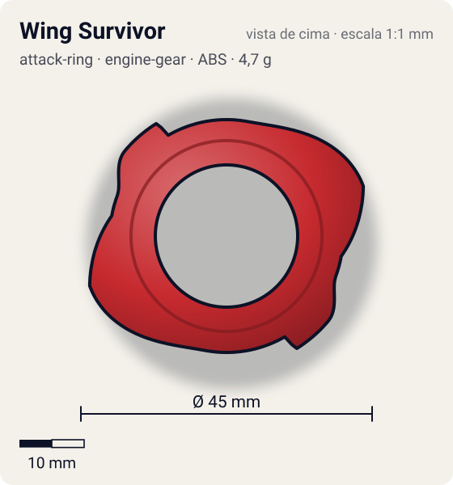
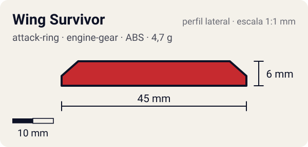

# Wing Survivor

<!-- auto:inicio (gerado por npm run build:research; não edite este bloco) -->
 

| Medidas e material | |
|---|---|
| Diâmetro | 45 estimado mm |
| Altura / espessura | 6 estimado mm |
| Peso | 4,7 wiki g |
| Material | ABS (opaco) |
| Estrelas Takara (A / D / S) | 2 / 1 / 3 |
| Usada em | [Dranzer G](../../../personagens/kai-hiwatari/beyblades/dranzer-g/) |
<!-- auto:fim -->

| Campo | Valor |
|---|---|
| Id | `attack-ring/wing-survivor` |
| Categoria | Attack Ring |
| Sistema | Engine Gear System |
| Material | ABS |
| Acabamento | opaco |
| Cores (primária / secundária / detalhe) | `#c62a2f` / `#f5f5f5` / `#2a5bc8` |

## Beys que usam

- `kai-hiwatari/dranzer-g` ([ficha](../../../personagens/kai-hiwatari/beyblades/dranzer-g/README.md))

## Formato

Simetria 2. Cada lado tem uma **asa** que sobe em rampa longa (~60°) até ~22,5 mm e cai numa ponta pouco afiada, seguida de um **segundo contato** menor e reto (~20,5 mm). Os ângulos dos contatos apontam para fora, o que explica o recoil.

Asas de fênix com contatos mal angulados e rampas para upper / force smash.

## Função em batalha

Muito recoil e smash fraco; o melhor uso é force smash (wiki, Dranzer G).

## Reação por sentido de rotação

- **Direita (horário visto de cima):** Sentido de fábrica: as rampas fazem force smash; os contatos batem mal (recoil alto).
- **Esquerda (anti-horário):** Contatos retos lideram: smash fraco com muito recoil.
- Sentido ótimo: **direita**. Tipo de contato: **slope**, 2 contato(s), recoil 0,75 (0–1, estimado).

## Combos conhecidos

- Wiki: o melhor uso é force smash, mas Smash Turtle faz isso melhor.

## Medidas, material e stats

| Item | Valor | Fonte |
|---|---|---|
| Diâmetro | 45 mm | estimado (2 × maior raio da `forma`) |
| Altura | 6 mm | estimado |
| Peso | 4,7 g | wiki |
| Material | ABS | — |
| Ataque / Defesa / Stamina | 2 / 1 / 3 | Beyblade Wiki, Part Infobox |
| Raio de contato | 22,5 mm | estimado |

## Forma (parâmetros do gerador de SVG)

Convenção: ângulos em graus, sentido horário visto de cima, 0° = topo; o setor (0 a 180°) se repete 2 vezes. Na rotação **direita** a face em `fim` é a que bate; na **esquerda**, a face em `inicio`. Anel base com raio 18 mm, furo central 11 mm, espessura 6 mm.

| início | pico | fim | raio (mm) | borda | altura (mm) | material |
|---|---|---|---|---|---|---|
| 10° | 70° | 100° | 22,5 | rampa | 6 | ABS/PC |
| 110° | 130° | 150° | 20,5 | reta | 6 | ABS/PC |

## Observações

Contagem de asas e cores aproximadas (sem foto local).

## Referências locais

- Nenhuma foto local desta peça no repositório.

## Fontes

- https://beyblade.fandom.com/wiki/Attack_Ring_-_Wing_Survivor
- https://beyblade.fandom.com/wiki/Dranzer_G
