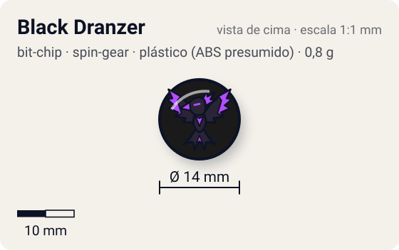
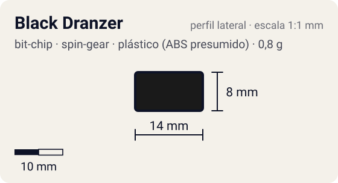

# Black Dranzer

<!-- auto:inicio (gerado por npm run build:research; não edite este bloco) -->
 

| Medidas e material | |
|---|---|
| Diâmetro | 14 estimado mm |
| Altura / espessura | 8 estimado mm |
| Peso | 0,8 comunidade g |
| Material | plástico (ABS presumido) + adesivo impresso com a fera (opaco) |
| Estrelas Takara (A / D / S) | — |
| Usada em | [Black Dranzer](../../../personagens/kai-hiwatari/beyblades/black-dranzer/) |
<!-- auto:fim -->

Bit Chip · sistema **spin-gear** · fera bit [`black-dranzer`](../../../feras-bit/black-dranzer/)

## Usado em

- `kai-hiwatari/black-dranzer`

## Tipo físico

Chip longo de uma peça (encaixa direto no Attack Ring). Peça única com haste longa que encaixa direto no furo central do Attack Ring.

## Arte

Fênix negra (Black Dranzer). Algumas versões da Hasbro saíram com o adesivo vermelho da Dranzer comum no lugar do da Black Dranzer (wiki). No anime, o chip "faz a alma do blader cair na escuridão" e sobrevive à destruição da bey.

Padrão dos adesivos Takara visto nas fotos locais (Wolborg, Griffolyon): anel externo colorido, disco central amarelo com borda preta dentada, fera ilustrada no centro e, às vezes, o nome em katakana.

## Medidas

| Medida | Valor | Fonte |
|---|---|---|
| Diâmetro | 14 mm | estimado (face visível) |
| Altura | 8 mm | estimado (inclui a haste que entra no Attack Ring) |
| Peso | 0,8 g | comunidade: medido pelo blog おばけブレーダー nas beys black-dranzer |

## Cores

Primária #1a1a1a · secundária #5b2a86 · detalhe #c8102e — fonte: estimado (fênix negra).

## Stats oficiais

Nenhum. A Takara não dava Ataque/Defesa/Stamina para o chip (a infobox da wiki fica vazia); as somas oficiais das beys usam só AR, WD e Blade Base.

## Fontes

- https://beyblade.fandom.com/wiki/Bit_Chip_-_Black_Dranzer
- https://beyblade.fandom.com/wiki/Black_Dranzer
- http://obakeblader.com/2018/06/18/post-436/
