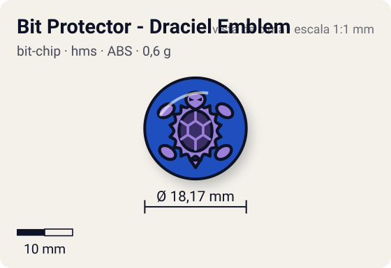
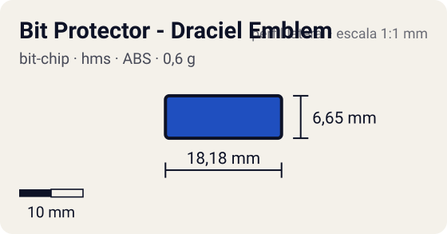

# Bit Protector - Draciel Emblem

<!-- auto:inicio (gerado por npm run build:research; não edite este bloco) -->
 

| Medidas e material | |
|---|---|
| Diâmetro | 18,2 comunidade mm |
| Altura / espessura | 6,7 comunidade mm |
| Peso | 0,6 comunidade g |
| Material | ABS + adesivo impresso (2 opções: emblema ou fera) (opaco) |
| Estrelas Takara (A / D / S) | — |
| Usada em | [Draciel MS](../../../personagens/max-tate/beyblades/draciel-ms/) |
<!-- auto:fim -->

Bit Protector · sistema **hms** · fera bit [`draciel`](../../../feras-bit/draciel/)

## Usado em

- `max-tate/draciel-ms`

## Tipo físico

Bit Protector (HMS, 1º molde). No HMS o Bit Protector é a trava que segura o Attack Ring e as demais peças; 1º molde, o mais frouxo.

## Arte

Protetor de ABS verde. Dois adesivos: emblema estilizado da cabeça da Draciel com "DRACIEL" e "Heavy/Hard Metal System" em branco, sobre fundo azul; ou a fera Draciel (wiki). A foto local mostra o protetor verde com o adesivo da fera: silhueta escura da tartaruga sobre disco amarelo-alaranjado.

## Medidas

| Medida | Valor | Fonte |
|---|---|---|
| Diâmetro | 18,17 mm | comunidade (largura total do Bit Protector da Strata Dragoon MS, mesmo 1º molde) |
| Altura | 6,65 mm | comunidade |
| Peso | 0,6 g | comunidade: medido pelo blog おばけブレーダー nas beys draciel-ms |

## Cores

Primária #1f4fbf · secundária #1e7a34 · detalhe #ffffff — fonte: wiki (protetor de ABS verde; emblema sobre fundo azul) + foto local (verde do plástico); hex estimado.

## Stats oficiais

Nenhum confirmado. A Takara não pontuava o Bit Protector: as somas de Ataque/Defesa/Stamina das caixas fecham só com Attack Ring, Weight Disk e Running Core/Base.

## Notas

- A infobox da wiki traz Weight 3, AttackStat 1, DefenseStat 3 e "EnduranceStat" 3 (campo que o template não exibe). Peso de 3 g contradiz os 0,6 g medidos de todos os Bit Protectors de 1º molde, e a soma Takara da Draciel MS (4/5/8) fecha só com AR + WD + Running Core; os valores da wiki parecem copiados de outra peça e foram descartados.

## Referência

- [referencia/bit-protector-draciel-ms.jpg](referencia/bit-protector-draciel-ms.jpg): cópia de `pesquisa-bakuten/personagens/max-tate/beyblades/draciel-ms/pecas/bit-protector.jpg`

## Fontes

- https://beyblade.fandom.com/wiki/Bit_Protector_-_Draciel_Emblem
- https://beyblade.fandom.com/wiki/Draciel_MS
- https://beyblade.fandom.com/wiki/Bit_Protector
- http://obakeblader.com/2018/09/13/post-1837/
- https://beyblade.fandom.com/wiki/Bit_Protector_-_Strata_Dragoon
