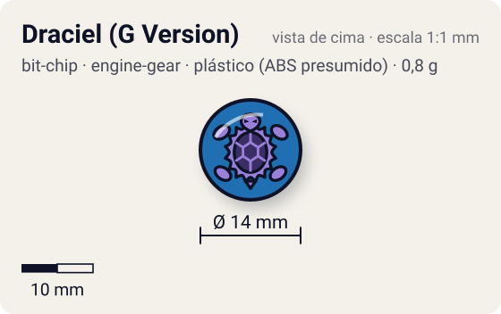
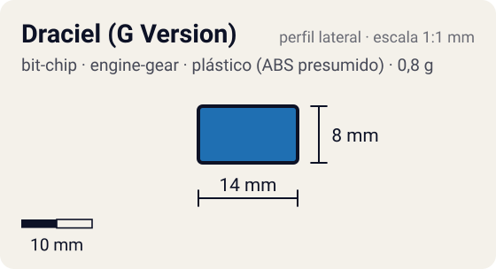

# Draciel (G Version)

<!-- auto:inicio (gerado por npm run build:research; não edite este bloco) -->
 

| Medidas e material | |
|---|---|
| Diâmetro | 14 estimado mm |
| Altura / espessura | 8 estimado mm |
| Peso | 0,8 comunidade g |
| Material | plástico (ABS presumido) + adesivo impresso com a fera (opaco) |
| Estrelas Takara (A / D / S) | — |
| Usada em | [Draciel G](../../../personagens/max-tate/beyblades/draciel-g/) |
<!-- auto:fim -->

Bit Chip · sistema **engine-gear** · fera bit [`draciel`](../../../feras-bit/draciel/)

## Usado em

- `max-tate/draciel-g`

## Tipo físico

Chip longo de uma peça (encaixa direto no Attack Ring). Peça única com haste longa que encaixa direto no furo central do Attack Ring.

## Arte

Draciel, arte da série G.

Padrão dos adesivos Takara visto nas fotos locais (Wolborg, Griffolyon): anel externo colorido, disco central amarelo com borda preta dentada, fera ilustrada no centro e, às vezes, o nome em katakana.

## Medidas

| Medida | Valor | Fonte |
|---|---|---|
| Diâmetro | 14 mm | estimado (face visível) |
| Altura | 8 mm | estimado (inclui a haste que entra no Attack Ring) |
| Peso | 0,8 g | comunidade: medido pelo blog おばけブレーダー nas beys draciel-g |

## Cores

Primária #1f6fb2 · secundária #f2c200 · detalhe #ffffff — fonte: estimado.

## Stats oficiais

Nenhum. A Takara não dava Ataque/Defesa/Stamina para o chip (a infobox da wiki fica vazia); as somas oficiais das beys usam só AR, WD e Blade Base.

## Fontes

- https://beyblade.fandom.com/wiki/Bit_Chip_-_Draciel
- https://beyblade.fandom.com/wiki/Draciel_G
- http://obakeblader.com/2018/06/19/post-603/
