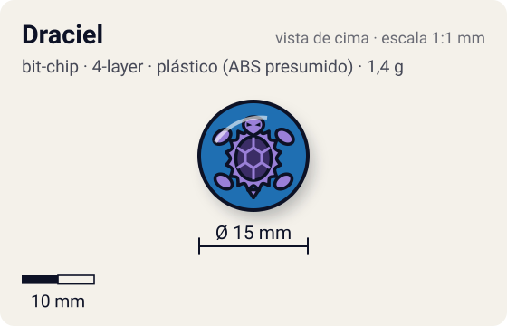
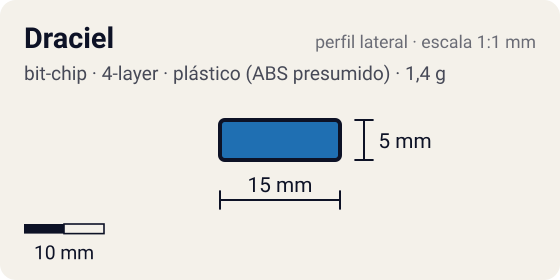

# Draciel

<!-- auto:inicio (gerado por npm run build:research; não edite este bloco) -->
 

| Medidas e material | |
|---|---|
| Diâmetro | 15 estimado mm |
| Altura / espessura | 5 estimado mm |
| Peso | 1,4 comunidade g |
| Material | plástico (ABS presumido) + tampa de fixação plástica (2ª peça) + adesivo impresso com a fera (opaco) |
| Estrelas Takara (A / D / S) | — |
| Usada em | [Draciel Metal Ball Defenser](../../../personagens/max-tate/beyblades/draciel-metal-ball-defenser/) |
<!-- auto:fim -->

Bit Chip · sistema **4-layer** · fera bit [`draciel`](../../../feras-bit/draciel/)

## Usado em

- `max-tate/draciel-metal-ball-defenser`

## Tipo físico

Chip de duas camadas (corpo + tampa de fixação). Chip das primeiras séries (Character Chip): corpo e tampa de fixação separados; o tipo mais pesado de chip.

## Arte

Draciel (Genbu, tartaruga negra da água). No mangá, antes de ganhar o chip, a bey se chamava Protociel.

Padrão dos adesivos Takara visto nas fotos locais (Wolborg, Griffolyon): anel externo colorido, disco central amarelo com borda preta dentada, fera ilustrada no centro e, às vezes, o nome em katakana.

## Medidas

| Medida | Valor | Fonte |
|---|---|---|
| Diâmetro | 15 mm | estimado (face visível) |
| Altura | 5 mm | estimado (corpo + tampa) |
| Peso | 1,4 g | comunidade: medido pelo blog おばけブレーダー nas beys draciel-metal-ball-defenser |

## Cores

Primária #1f6fb2 · secundária #f2c200 · detalhe #ffffff — fonte: estimado (cor da fera).

## Stats oficiais

Nenhum. A Takara não dava Ataque/Defesa/Stamina para o chip (a infobox da wiki fica vazia); as somas oficiais das beys usam só AR, WD e Blade Base.

## Notas

- A lista bruta juntava Draciel Metal Ball Defenser e Draciel S em "Draciel"; foram separados porque o chip da MBD é de duas camadas (1,4 g) e o da S é de peça única (0,8 g).

## Fontes

- https://beyblade.fandom.com/wiki/Bit_Chip_-_Draciel
- https://beyblade.fandom.com/wiki/Draciel_Metal_Ball_Defenser
- http://obakeblader.com/2018/06/25/post-937/
