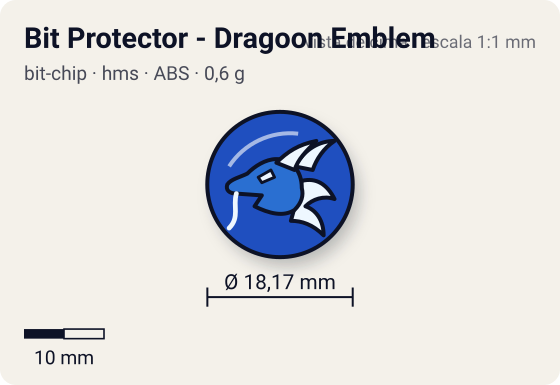
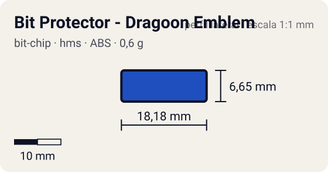

# Bit Protector - Dragoon Emblem

<!-- auto:inicio (gerado por npm run build:research; não edite este bloco) -->
 

| Medidas e material | |
|---|---|
| Diâmetro | 18,2 comunidade mm |
| Altura / espessura | 6,7 comunidade mm |
| Peso | 0,6 comunidade g |
| Material | ABS + adesivo impresso (2 opções: emblema ou fera) (opaco) |
| Estrelas Takara (A / D / S) | — |
| Usada em | [Dragoon MS (Dragoon Metal Storm)](../../../personagens/tyson-granger/beyblades/dragoon-ms/), [Dragoon MS Ultimate Version](../../../personagens/tyson-granger/beyblades/dragoon-ms-ultimate-version/) |
<!-- auto:fim -->

Bit Protector · sistema **hms** · fera bit [`dragoon`](../../../feras-bit/dragoon/)

## Usado em

- `tyson-granger/dragoon-ms`
- `tyson-granger/dragoon-ms-ultimate-version`

## Tipo físico

Bit Protector (HMS, 1º molde). No HMS o Bit Protector é a trava que segura o Attack Ring e as demais peças; 1º molde, o mais frouxo.

## Arte

Protetor de ABS branco (1º molde, o mais frouxo). Dois adesivos: emblema estilizado da cabeça do Dragoon com "DRAGOON" e "Beyblade Metal System" em branco, sobre fundo azul (Dragoon MS) ou vermelho (MS Ultimate Version); ou a fera Dragoon ilustrada (na Ultimate Version, sobre fundo amarelo, arte diferente da MS).

## Medidas

| Medida | Valor | Fonte |
|---|---|---|
| Diâmetro | 18,17 mm | comunidade (largura total do Bit Protector da Strata Dragoon MS, mesmo 1º molde) |
| Altura | 6,65 mm | comunidade |
| Peso | 0,6 g | comunidade: medido pelo blog おばけブレーダー nas beys dragoon-ms, dragoon-ms-ultimate-version |

## Cores

Primária #1f4fbf · secundária #ffffff · detalhe #c8102e — fonte: wiki (protetor de ABS branco; adesivo do emblema com fundo azul na MS e vermelho na MS Ultimate Version); hex estimado.

## Stats oficiais

Nenhum confirmado. A Takara não pontuava o Bit Protector: as somas de Ataque/Defesa/Stamina das caixas fecham só com Attack Ring, Weight Disk e Running Core/Base.

## Fontes

- https://beyblade.fandom.com/wiki/Bit_Protector_-_Dragoon_Emblem
- https://beyblade.fandom.com/wiki/Dragoon_MS
- https://beyblade.fandom.com/wiki/Dragoon_MS_Ultimate_Version
- https://beyblade.fandom.com/wiki/Bit_Protector
- http://obakeblader.com/2018/08/02/post-1429/
- http://obakeblader.com/2018/08/02/post-1508/
- https://beyblade.fandom.com/wiki/Bit_Protector_-_Strata_Dragoon
