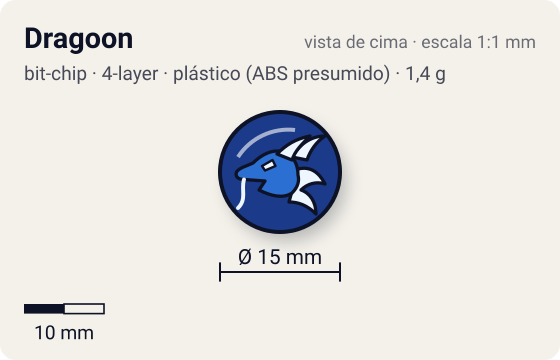
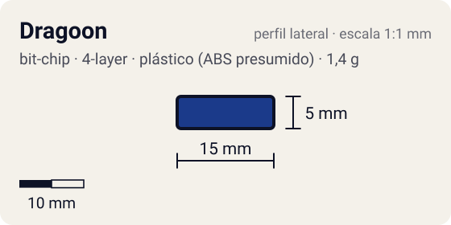

# Dragoon

<!-- auto:inicio (gerado por npm run build:research; não edite este bloco) -->
 

| Medidas e material | |
|---|---|
| Diâmetro | 15 estimado mm |
| Altura / espessura | 5 estimado mm |
| Peso | 1,4 comunidade g |
| Material | plástico (ABS presumido) + tampa de fixação plástica (2ª peça) + adesivo impresso com a fera (opaco) |
| Estrelas Takara (A / D / S) | — |
| Usada em | [Dragoon Grip Attacker](../../../personagens/tyson-granger/beyblades/dragoon-grip-attacker/), [Dragoon S (Dragoon Storm)](../../../personagens/tyson-granger/beyblades/dragoon-s/) |
<!-- auto:fim -->

Bit Chip · sistema **4-layer** · fera bit [`dragoon`](../../../feras-bit/dragoon/)

## Usado em

- `tyson-granger/dragoon-grip-attacker`
- `tyson-granger/dragoon-s`

## Tipo físico

Chip de duas camadas (corpo + tampa de fixação). Chip das primeiras séries (Character Chip): corpo e tampa de fixação separados; o tipo mais pesado de chip.

## Arte

Dragoon (Seiryū, dragão azul do vento). A wiki mostra a arte na foto "DragoonBitChip.jpg" (infobox), sem descrição de cores.

Padrão dos adesivos Takara visto nas fotos locais (Wolborg, Griffolyon): anel externo colorido, disco central amarelo com borda preta dentada, fera ilustrada no centro e, às vezes, o nome em katakana.

## Medidas

| Medida | Valor | Fonte |
|---|---|---|
| Diâmetro | 15 mm | estimado (face visível) |
| Altura | 5 mm | estimado (corpo + tampa) |
| Peso | 1,4 g | comunidade: medido pelo blog おばけブレーダー nas beys dragoon-grip-attacker, dragoon-s |

## Cores

Primária #1b3a8a · secundária #f2c200 · detalhe #ffffff — fonte: estimado (cor da fera; sem foto local do chip).

## Stats oficiais

Nenhum. A Takara não dava Ataque/Defesa/Stamina para o chip (a infobox da wiki fica vazia); as somas oficiais das beys usam só AR, WD e Blade Base.

## Notas

- Estreou na Dragoon Grip Attacker (1999). A versão japonesa dos chips dessa época trazia um código para destravar a fera no jogo Beyblade Fighting Tournament (GBC).

## Fontes

- https://beyblade.fandom.com/wiki/Bit_Chip_-_Dragoon
- https://beyblade.fandom.com/wiki/Dragoon_Grip_Attacker
- https://beyblade.fandom.com/wiki/Dragoon_S
- http://obakeblader.com/2018/06/17/post-233/
- http://obakeblader.com/2018/06/17/post-347/
