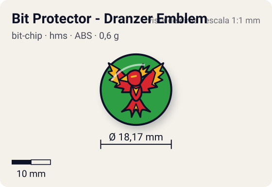
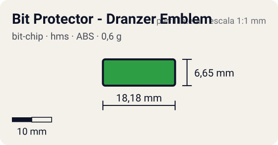

# Bit Protector - Dranzer Emblem

<!-- auto:inicio (gerado por npm run build:research; não edite este bloco) -->
 

| Medidas e material | |
|---|---|
| Diâmetro | 18,2 comunidade mm |
| Altura / espessura | 6,7 comunidade mm |
| Peso | 0,6 comunidade g |
| Material | ABS + adesivo impresso (2 opções: emblema ou fera) (opaco) |
| Estrelas Takara (A / D / S) | — |
| Usada em | [Dranzer MS](../../../personagens/kai-hiwatari/beyblades/dranzer-ms/) |
<!-- auto:fim -->

Bit Protector · sistema **hms** · fera bit [`dranzer`](../../../feras-bit/dranzer/)

## Usado em

- `kai-hiwatari/dranzer-ms`

## Tipo físico

Bit Protector (HMS, 1º molde). No HMS o Bit Protector é a trava que segura o Attack Ring e as demais peças; 1º molde, o mais frouxo.

## Arte

Protetor de ABS azul. Dois adesivos: emblema estilizado da cabeça do Dranzer com "DRANZER" e "Heavy/Hard Metal System" em branco, sobre fundo verde; ou a fera Dranzer (wiki, página Dranzer MS). A página da peça descreve a silhueta estilizada da fênix com "Dranzer" e "Beyblade Metal System" embaixo.

## Medidas

| Medida | Valor | Fonte |
|---|---|---|
| Diâmetro | 18,17 mm | comunidade (largura total do Bit Protector da Strata Dragoon MS, mesmo 1º molde) |
| Altura | 6,65 mm | comunidade |
| Peso | 0,6 g | comunidade: medido pelo blog おばけブレーダー nas beys dranzer-ms |

## Cores

Primária #2e9e44 · secundária #1f4fbf · detalhe #ffffff — fonte: wiki (protetor de ABS azul; emblema sobre fundo verde); hex estimado.

## Stats oficiais

Nenhum confirmado. A Takara não pontuava o Bit Protector: as somas de Ataque/Defesa/Stamina das caixas fecham só com Attack Ring, Weight Disk e Running Core/Base.

## Notas

- A infobox da wiki traz AttackStat 1, DefenseStat 2 e um campo "EnduranceStat" 1 que o template não exibe. Não há fonte Takara para isso e a soma Takara da Dranzer MS não inclui o Bit Protector; tratado como não confirmado.

## Fontes

- https://beyblade.fandom.com/wiki/Bit_Protector_-_Dranzer_Emblem
- https://beyblade.fandom.com/wiki/Dranzer_MS
- https://beyblade.fandom.com/wiki/Bit_Protector
- http://obakeblader.com/2018/09/13/post-1854/
- https://beyblade.fandom.com/wiki/Bit_Protector_-_Strata_Dragoon
