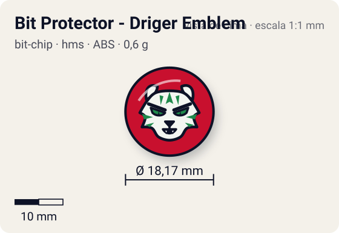
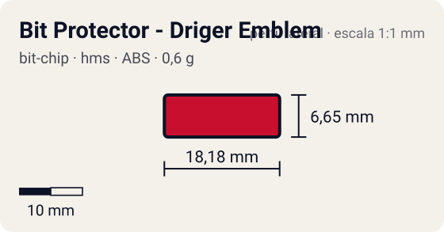

# Bit Protector - Driger Emblem

<!-- auto:inicio (gerado por npm run build:research; não edite este bloco) -->
 

| Medidas e material | |
|---|---|
| Diâmetro | 18,2 comunidade mm |
| Altura / espessura | 6,7 comunidade mm |
| Peso | 0,6 comunidade g |
| Material | ABS + adesivo impresso (2 opções: emblema ou fera) (opaco) |
| Estrelas Takara (A / D / S) | — |
| Usada em | [Driger MS](../../../personagens/ray-kon/beyblades/driger-ms/) |
<!-- auto:fim -->

Bit Protector · sistema **hms** · fera bit [`driger`](../../../feras-bit/driger/)

## Usado em

- `ray-kon/driger-ms`

## Tipo físico

Bit Protector (HMS, 1º molde). No HMS o Bit Protector é a trava que segura o Attack Ring e as demais peças; 1º molde, o mais frouxo.

## Arte

Protetor de ABS preto. Dois adesivos: emblema branco estilizado da cabeça do Driger com "DRIGER" e "Heavy/Hard Metal System" em letra branca pequena, sobre adesivo redondo vermelho; ou adesivo amarelo com o Driger de corpo inteiro (wiki, página Driger MS).

## Medidas

| Medida | Valor | Fonte |
|---|---|---|
| Diâmetro | 18,17 mm | comunidade (largura total do Bit Protector da Strata Dragoon MS, mesmo 1º molde) |
| Altura | 6,65 mm | comunidade |
| Peso | 0,6 g | comunidade: medido pelo blog おばけブレーダー nas beys driger-ms |

## Cores

Primária #c8102e · secundária #1a1a1a · detalhe #ffffff — fonte: wiki (protetor de ABS preto; emblema branco sobre adesivo vermelho; alternativa amarela); hex estimado.

## Stats oficiais

Nenhum confirmado. A Takara não pontuava o Bit Protector: as somas de Ataque/Defesa/Stamina das caixas fecham só com Attack Ring, Weight Disk e Running Core/Base.

## Notas

- A wiki não tem página própria desta peça; dados da página da Driger MS.

## Fontes

- https://beyblade.fandom.com/wiki/Driger_MS
- https://beyblade.fandom.com/wiki/Bit_Protector
- http://obakeblader.com/2018/09/13/post-1846/
- https://beyblade.fandom.com/wiki/Bit_Protector_-_Strata_Dragoon
