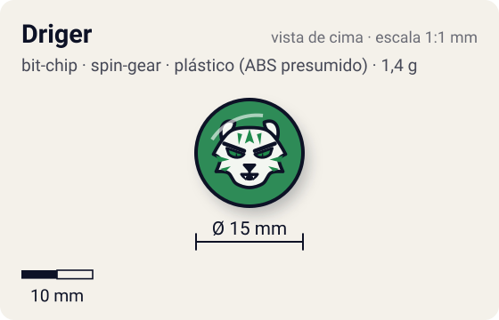
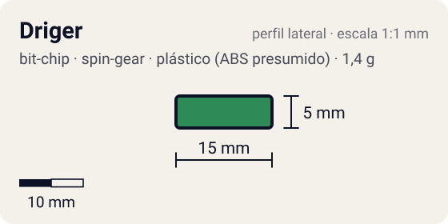

# Driger

<!-- auto:inicio (gerado por npm run build:research; não edite este bloco) -->
 

| Medidas e material | |
|---|---|
| Diâmetro | 15 estimado mm |
| Altura / espessura | 5 estimado mm |
| Peso | 1,4 comunidade g |
| Material | plástico (ABS presumido) + tampa de fixação plástica (2ª peça) + adesivo impresso com a fera (opaco) |
| Estrelas Takara (A / D / S) | — |
| Usada em | [Driger S](../../../personagens/ray-kon/beyblades/driger-s/) |
<!-- auto:fim -->

Bit Chip · sistema **spin-gear** · fera bit [`driger`](../../../feras-bit/driger/)

## Usado em

- `ray-kon/driger-s`

## Tipo físico

Chip de duas camadas (corpo + tampa de fixação). Chip das primeiras séries (Character Chip): corpo e tampa de fixação separados; o tipo mais pesado de chip.

## Arte

Driger (Byakko, tigre branco da terra). Foto da infobox da wiki: "Driger_S_Bit_Chip.jpg". A versão japonesa trazia o código "GER4" para destravar a fera em Beyblade Fighting Tournament.

Padrão dos adesivos Takara visto nas fotos locais (Wolborg, Griffolyon): anel externo colorido, disco central amarelo com borda preta dentada, fera ilustrada no centro e, às vezes, o nome em katakana.

## Medidas

| Medida | Valor | Fonte |
|---|---|---|
| Diâmetro | 15 mm | estimado (face visível) |
| Altura | 5 mm | estimado (corpo + tampa) |
| Peso | 1,4 g | comunidade: medido pelo blog おばけブレーダー nas beys driger-s |

## Cores

Primária #2e8b57 · secundária #f2c200 · detalhe #ffffff — fonte: estimado (cor da fera).

## Stats oficiais

Nenhum. A Takara não dava Ataque/Defesa/Stamina para o chip (a infobox da wiki fica vazia); as somas oficiais das beys usam só AR, WD e Blade Base.

## Notas

- A lista bruta juntava Driger S e Driger V em "Driger"; foram separados porque o chip da S é de duas camadas (1,4 g) e o da V é de peça única (0,8 g), com arte própria na wiki ("Driger V.jpg").

## Fontes

- https://beyblade.fandom.com/wiki/Bit_Chip_-_Driger
- https://beyblade.fandom.com/wiki/Driger_S
- https://beyblade.fandom.com/wiki/Beyblade_Fighting_Tournament
- http://obakeblader.com/2018/10/16/post-2313/
