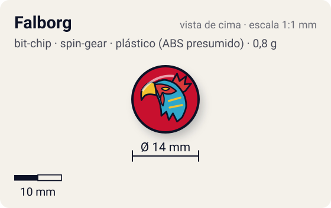
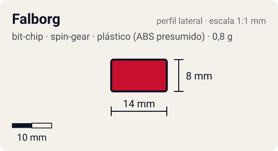

# Falborg

<!-- auto:inicio (gerado por npm run build:research; não edite este bloco) -->
 

| Medidas e material | |
|---|---|
| Diâmetro | 14 estimado mm |
| Altura / espessura | 8 estimado mm |
| Peso | 0,8 estimado g |
| Material | plástico (ABS presumido) + adesivo impresso com a fera (opaco) |
| Estrelas Takara (A / D / S) | — |
| Usada em | [Falborg](../../../personagens/bryan-kuznetsov/beyblades/falborg/), [Falborg 2](../../../personagens/bryan-kuznetsov/beyblades/falborg-2/) |
<!-- auto:fim -->

Bit Chip · sistema **spin-gear** · fera bit [`falborg`](../../../feras-bit/falborg/)

## Usado em

- `bryan-kuznetsov/falborg`
- `bryan-kuznetsov/falborg-2`

## Tipo físico

Chip longo de uma peça (encaixa direto no Attack Ring). Peça única com haste longa que encaixa direto no furo central do Attack Ring.

## Arte

Falcão Falborg. A bey nunca foi lançada como brinquedo (a wiki chama o chip de "unreleased"); a arte só existe no anime, no mangá e na figurinha "Bey, Falborg Bit Sticker Ver 1.jpg".

Padrão dos adesivos Takara visto nas fotos locais (Wolborg, Griffolyon): anel externo colorido, disco central amarelo com borda preta dentada, fera ilustrada no centro e, às vezes, o nome em katakana.

## Medidas

| Medida | Valor | Fonte |
|---|---|---|
| Diâmetro | 14 mm | estimado (face visível) |
| Altura | 8 mm | estimado (inclui a haste que entra no Attack Ring) |
| Peso | 0,8 g | estimado: sem brinquedo; valor do chip de peça única típico |

## Cores

Primária #c8102e · secundária #1f4fbf · detalhe #f2c200 — fonte: estimado (no anime: falcão azul/amarelo sobre fundo vermelho).

## Stats oficiais

Nenhum. A Takara não dava Ataque/Defesa/Stamina para o chip (a infobox da wiki fica vazia); as somas oficiais das beys usam só AR, WD e Blade Base.

## Notas

- Sem brinquedo: peso e medidas copiados do chip de peça única típico (estimado).

## Fontes

- https://beyblade.fandom.com/wiki/Bit_Chip_-_Falborg
- https://beyblade.fandom.com/wiki/Falborg
