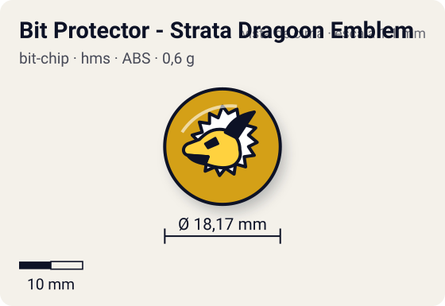
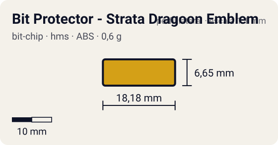

# Bit Protector - Strata Dragoon Emblem

<!-- auto:inicio (gerado por npm run build:research; não edite este bloco) -->
 

| Medidas e material | |
|---|---|
| Diâmetro | 18,2 wiki mm |
| Altura / espessura | 6,7 wiki mm |
| Peso | 0,6 comunidade g |
| Material | ABS + adesivo impresso (2 opções: emblema ou fera) (opaco) |
| Estrelas Takara (A / D / S) | — |
| Usada em | [Gaia Dragoon MS (Strata Dragoon MS / Metal Spike)](../../../personagens/daichi-sumeragi/beyblades/gaia-dragoon-ms/) |
<!-- auto:fim -->

Bit Protector · sistema **hms** · fera bit [`gaia-dragoon`](../../../feras-bit/gaia-dragoon/)

## Usado em

- `daichi-sumeragi/gaia-dragoon-ms`

## Tipo físico

Bit Protector (HMS, 1º molde). No HMS o Bit Protector é a trava que segura o Attack Ring e as demais peças; 1º molde, o mais frouxo.

## Arte

Emblema "Gaia" (Strata Dragoon Emblem), 1º molde de Bit Protector. A wiki não descreve cores do adesivo.

## Medidas

| Medida | Valor | Fonte |
|---|---|---|
| Diâmetro | 18,17 mm | wiki (largura total, wiki) |
| Altura | 6,65 mm | wiki |
| Peso | 0,6 g | comunidade: medido pelo blog おばけブレーダー nas beys gaia-dragoon-ms |

## Cores

Primária #d4a017 · secundária #1a1a1a · detalhe #ffffff — fonte: estimado (sem descrição de cores na wiki).

## Stats oficiais

Nenhum confirmado. A Takara não pontuava o Bit Protector: as somas de Ataque/Defesa/Stamina das caixas fecham só com Attack Ring, Weight Disk e Running Core/Base.

## Fontes

- https://beyblade.fandom.com/wiki/Bit_Protector_-_Strata_Dragoon
- https://beyblade.fandom.com/wiki/Bit_Protector_-_Strata_Dragoon_Emblem
- https://beyblade.fandom.com/wiki/Gaia_Dragoon_MS
- http://obakeblader.com/2018/09/13/post-1884/
