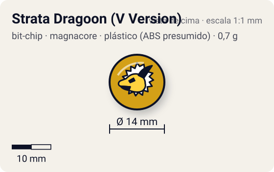
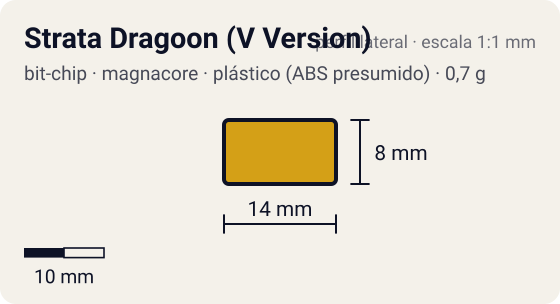

# Strata Dragoon (V Version)

<!-- auto:inicio (gerado por npm run build:research; não edite este bloco) -->
 

| Medidas e material | |
|---|---|
| Diâmetro | 14 estimado mm |
| Altura / espessura | 8 estimado mm |
| Peso | 0,7 comunidade g |
| Material | plástico (ABS presumido) + adesivo impresso com a fera (opaco) |
| Estrelas Takara (A / D / S) | — |
| Usada em | [Gaia Dragoon V (Strata Dragoon V / Vast)](../../../personagens/daichi-sumeragi/beyblades/gaia-dragoon-v/) |
<!-- auto:fim -->

Bit Chip · sistema **magnacore** · fera bit [`gaia-dragoon`](../../../feras-bit/gaia-dragoon/)

## Usado em

- `daichi-sumeragi/gaia-dragoon-v`

## Tipo físico

Chip compatível com o Bit Finder (com rebaixos internos). Variante da série V2 descrita como "compatível com Bit Finder" (ビットファインダー対応; o que é o Bit Finder não foi confirmado); tem rebaixos internos (肉抜き) e é um pouco mais leve.

## Arte

Strata/Gaia Dragoon, arte da série V.

Padrão dos adesivos Takara visto nas fotos locais (Wolborg, Griffolyon): anel externo colorido, disco central amarelo com borda preta dentada, fera ilustrada no centro e, às vezes, o nome em katakana.

## Medidas

| Medida | Valor | Fonte |
|---|---|---|
| Diâmetro | 14 mm | estimado (face visível) |
| Altura | 8 mm | estimado (inclui a haste que entra no Attack Ring) |
| Peso | 0,7 g | comunidade: medido pelo blog おばけブレーダー nas beys gaia-dragoon-v |

## Cores

Primária #d4a017 · secundária #7a4a12 · detalhe #ffffff — fonte: estimado.

## Stats oficiais

Nenhum. A Takara não dava Ataque/Defesa/Stamina para o chip (a infobox da wiki fica vazia); as somas oficiais das beys usam só AR, WD e Blade Base.

## Fontes

- https://beyblade.fandom.com/wiki/Bit_Chip_-_Strata_Dragoon
- https://beyblade.fandom.com/wiki/Gaia_Dragoon_V
- http://obakeblader.com/2018/10/27/post-3634/
