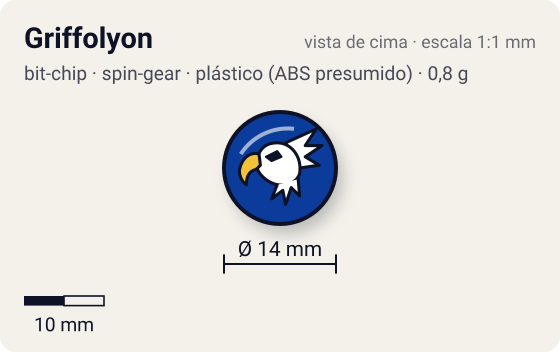
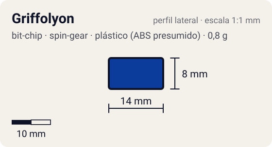

# Griffolyon

<!-- auto:inicio (gerado por npm run build:research; não edite este bloco) -->
 

| Medidas e material | |
|---|---|
| Diâmetro | 14 estimado mm |
| Altura / espessura | 8 estimado mm |
| Peso | 0,8 comunidade g |
| Material | plástico (ABS presumido) + adesivo impresso com a fera (opaco) |
| Estrelas Takara (A / D / S) | — |
| Usada em | [Griffolyon](../../../personagens/robert-jurgen/beyblades/griffolyon/) |
<!-- auto:fim -->

Bit Chip · sistema **spin-gear** · fera bit [`griffolyon`](../../../feras-bit/griffolyon/)

## Usado em

- `robert-jurgen/griffolyon`

## Tipo físico

Chip longo de uma peça (encaixa direto no Attack Ring). Peça única com haste longa que encaixa direto no furo central do Attack Ring.

## Arte

Foto local: anel externo azul, disco central amarelo com borda preta dentada, grifo com asas brancas, corpo azul, patas traseiras vermelhas e garras amarelas.

Padrão dos adesivos Takara visto nas fotos locais (Wolborg, Griffolyon): anel externo colorido, disco central amarelo com borda preta dentada, fera ilustrada no centro e, às vezes, o nome em katakana.

## Medidas

| Medida | Valor | Fonte |
|---|---|---|
| Diâmetro | 14 mm | estimado (face visível) |
| Altura | 8 mm | estimado (inclui a haste que entra no Attack Ring) |
| Peso | 0,8 g | comunidade: medido pelo blog おばけブレーダー nas beys griffolyon |

## Cores

Primária #0b3c9c · secundária #f7ec00 · detalhe #1a1a1a — fonte: foto local (adesivo): anel azul, disco amarelo, borda preta dentada.

## Stats oficiais

Nenhum. A Takara não dava Ataque/Defesa/Stamina para o chip (a infobox da wiki fica vazia); as somas oficiais das beys usam só AR, WD e Blade Base.

## Referência

- [referencia/bit-chip-griffolyon.png](referencia/bit-chip-griffolyon.png): cópia de `pesquisa-bakuten/personagens/robert-jurgen/beyblades/griffolyon/pecas/bit-chip.png`

## Fontes

- https://beyblade.fandom.com/wiki/Bit_Chip_-_Griffolyon
- https://beyblade.fandom.com/wiki/Griffolyon
- http://obakeblader.com/2018/09/13/post-2008/
