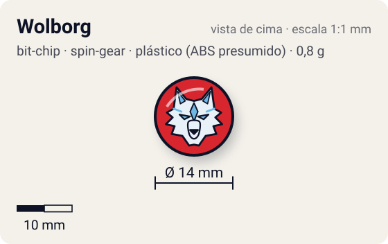
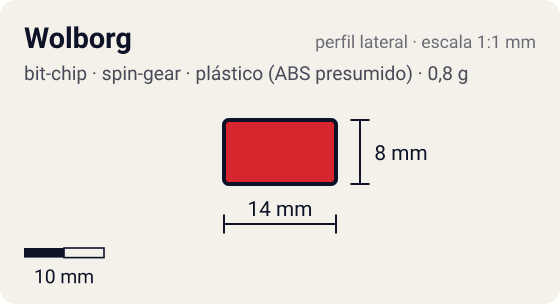

# Wolborg

<!-- auto:inicio (gerado por npm run build:research; não edite este bloco) -->
 

| Medidas e material | |
|---|---|
| Diâmetro | 14 estimado mm |
| Altura / espessura | 8 estimado mm |
| Peso | 0,8 comunidade g |
| Material | plástico (ABS presumido) + adesivo impresso com a fera (opaco) |
| Estrelas Takara (A / D / S) | — |
| Usada em | [Wolborg 2](../../../personagens/tala/beyblades/wolborg-2/), [Wolborg 4](../../../personagens/tala/beyblades/wolborg-4/) |
<!-- auto:fim -->

Bit Chip · sistema **spin-gear** · fera bit [`wolborg`](../../../feras-bit/wolborg/)

## Usado em

- `tala/wolborg-2`
- `tala/wolborg-4`

## Tipo físico

Chip longo de uma peça (encaixa direto no Attack Ring). Peça única com haste longa que encaixa direto no furo central do Attack Ring.

## Arte

Foto local: anel externo vermelho, disco central amarelo com borda preta dentada, Wolborg (lobo branco com detalhes verdes e azuis, com garras) no centro e "ウルボーグ" em katakana preto embaixo. Elemento gelo.

Padrão dos adesivos Takara visto nas fotos locais (Wolborg, Griffolyon): anel externo colorido, disco central amarelo com borda preta dentada, fera ilustrada no centro e, às vezes, o nome em katakana.

## Medidas

| Medida | Valor | Fonte |
|---|---|---|
| Diâmetro | 14 mm | estimado (face visível) |
| Altura | 8 mm | estimado (inclui a haste que entra no Attack Ring) |
| Peso | 0,8 g | comunidade: medido pelo blog おばけブレーダー nas beys wolborg-2, wolborg-4 |

## Cores

Primária #d7262e · secundária #f5d90a · detalhe #1a1a1a — fonte: foto local (adesivo): anel vermelho, disco amarelo, borda preta dentada.

## Stats oficiais

Nenhum. A Takara não dava Ataque/Defesa/Stamina para o chip (a infobox da wiki fica vazia); as somas oficiais das beys usam só AR, WD e Blade Base.

## Notas

- As fotos de wolborg-2 e wolborg-4 são o mesmo arquivo (mesmo MD5); copiado uma vez.

## Referência

- [referencia/bit-chip-wolborg.png](referencia/bit-chip-wolborg.png): cópia de `pesquisa-bakuten/personagens/tala/beyblades/wolborg-2/pecas/bit-chip.png`

## Fontes

- https://beyblade.fandom.com/wiki/Bit_Chip_-_Wolborg
- https://beyblade.fandom.com/wiki/Wolborg_2
- https://beyblade.fandom.com/wiki/Wolborg_4
- http://obakeblader.com/2018/10/16/post-2287/
- http://obakeblader.com/2018/06/18/post-514/
