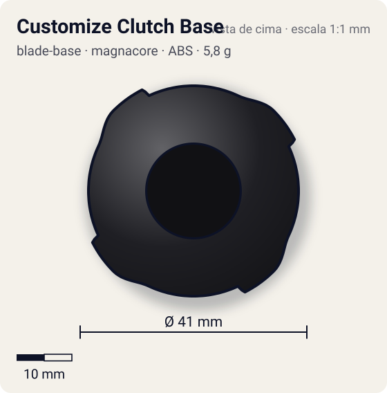
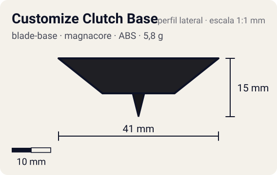

# Customize Clutch Base

<!-- auto:inicio (gerado por npm run build:research; não edite este bloco) -->
 

| Medidas e material | |
|---|---|
| Diâmetro | 41 estimado mm |
| Altura / espessura | 15 estimado mm |
| Peso | 5,8 wiki g |
| Material | ABS + Mola de aço (clutch) (opaco) |
| Estrelas Takara (A / D / S) | 3 / 1 / 3 |
| Usada em | [Dranzer V2](../../../personagens/kai-hiwatari/beyblades/dranzer-v2/) |
<!-- auto:fim -->

Blade Base · sistema **magnacore**

## Formato
Base da Dranzer V2 (série V2, aceita Support Parts) com ponta sharp que recolhe sozinha em batalha, deixando uma ponta mais larga.

## Função em batalha
Começa no centro em modo Survival e passa sozinha para Attack (flower rápido) quando a rotação cai.

## Gimmick: como funciona
1. No lançamento a ponta sharp está para fora; a força centrífuga mantém a trava do clutch na posição.
2. Enquanto a RPM é alta, a bey gira na sharp, parada no centro.
3. Quando a RPM cai abaixo do limiar, a trava cede e a sharp recolhe para dentro.
4. A borda mais larga (semi-flat) passa a tocar o piso e a bey começa a andar em flower.

| Modo | Ponta | Atrito | Gatilho |
|---|---|---|---|
| Survival Mode | sharp | 0,1 | lançamento: ponta sharp exposta enquanto a RPM está alta |
| Attack Mode | semi-flat | 0,3 | RPM abaixo de um limiar não especificado (varia de peça para peça; WD e SG mais pesados atrasam a troca) |

## Padrão de movimento no estádio
Primeiro centro, depois flower rápido; o modo Attack tem pouca stamina. (`padrao_movimento`: centro; ponta sharp, atrito de referência 0,1.)

## Beys que usam
- `kai-hiwatari/dranzer-v2` ([ficha](../../../personagens/kai-hiwatari/beyblades/dranzer-v2/README.md))

## Medidas, material e stats
| Item | Valor | Fonte |
|---|---|---|
| Diâmetro | 41 mm | estimado |
| Altura (com ponta) | 15 mm | estimado |
| Peso | 5,8 g | wiki |
| Material | ABS + Mola de aço (clutch) | Ponta plástica retrátil; mola presumida no mecanismo de clutch (estimado). |
| Ponta | sharp, raio 1,5 mm | estimado (tipo pela wiki/ficha da bey) |
| Ataque / Defesa / Stamina | 3 / 1 / 3 | Beyblade Wiki, Part Infobox (Customize Clutch Base) |
| Cores | primária #1f1f24, secundária #c8102e, detalhe #e0e0e0 | estimado (sem foto local) |

## Referências locais
- Nenhuma foto local desta peça no repositório.

## Notas e incertezas
- Limiar de RPM não especificado pela wiki ("cada base é única").
- Tipo da ponta após a troca (semi-flat) vem da ficha da bey; cores estimadas.

## Fontes
- https://beyblade.fandom.com/wiki/Blade_Base_-_Customize_Clutch_Base
- `pesquisa-bakuten/personagens/kai-hiwatari/beyblades/dranzer-v2/dados.json`
