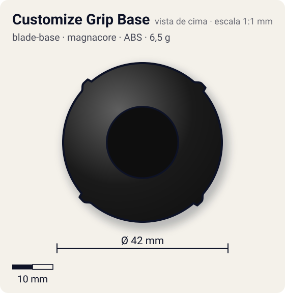
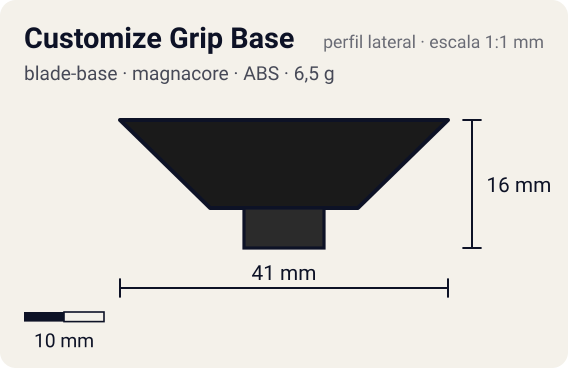

# Customize Grip Base

<!-- auto:inicio (gerado por npm run build:research; não edite este bloco) -->
 

| Medidas e material | |
|---|---|
| Diâmetro | 42 estimado mm |
| Altura / espessura | 16 estimado mm |
| Peso | 6,5 wiki g |
| Material | ABS + Borracha (ponta removível) + Ímã (na ponta) (opaco) |
| Estrelas Takara (A / D / S) | 4 / 1 / 1 |
| Usada em | [Dragoon V2 (Dragoon Victory 2)](../../../personagens/tyson-granger/beyblades/dragoon-v2/) |
<!-- auto:fim -->

Blade Base · sistema **magnacore**

## Formato
Base relativamente alta, com fundo liso dividido em quatro quadrantes por uma cruz em relevo com detalhes de parafuso; eixo central largo com ponta azul de borracha removível.

## Função em batalha
Ataque muito rápido e versátil (aceita núcleos, SPs e outras pontas). A altura atrapalha contra beys baixas e as bordas arredondadas escorregam no tornado ridge (auto-KO).

## Gimmick: como funciona
1. A ponta de borracha encaixa no furo do eixo e pode ser trocada.
2. A ponta tem um ímã para o estádio Magnacore.
3. O eixo largo aceita SGs de rolamento; os encaixes laterais recebem Support Parts.

## Padrão de movimento no estádio
Flower muito rápido; tende a passar por cima do tornado ridge e sair do estádio. (`padrao_movimento`: agressivo; ponta grip, atrito de referência 0,85.)

## Beys que usam
- `tyson-granger/dragoon-v2` ([ficha](../../../personagens/tyson-granger/beyblades/dragoon-v2/README.md))

## Medidas, material e stats
| Item | Valor | Fonte |
|---|---|---|
| Diâmetro | 42 mm | estimado |
| Altura (com ponta) | 16 mm | estimado |
| Peso | 6,5 g | wiki |
| Material | ABS + Borracha (ponta removível), Ímã (na ponta) | Ponta flat de borracha azul, bordas arredondadas, removível e com ímã. |
| Ponta | grip, raio 5 mm | estimado (tipo pela wiki/ficha da bey) |
| Ataque / Defesa / Stamina | sem stats oficiais | — |
| Cores | primária #1a1a1a, secundária #1f3f9a, detalhe #c0c0c0 | estimado (sem foto local) |

## Referências locais
- Nenhuma foto local desta peça no repositório.

## Notas e incertezas
- Peso: base 4,7 g + ponta 1,8 g = 6,5 g (wiki).
- Cores estimadas.

## Fontes
- https://beyblade.fandom.com/wiki/Blade_Base_-_Customize_Grip_Base
- `pesquisa-bakuten/personagens/tyson-granger/beyblades/dragoon-v2/dados.json`
