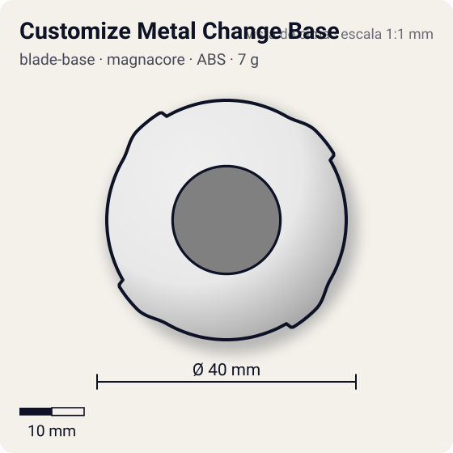
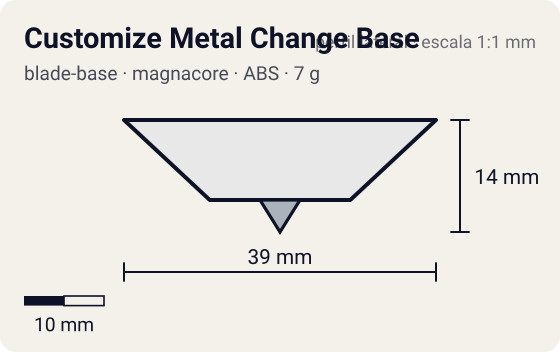

# Customize Metal Change Base

<!-- auto:inicio (gerado por npm run build:research; não edite este bloco) -->
 

| Medidas e material | |
|---|---|
| Diâmetro | 40 estimado mm |
| Altura / espessura | 14 estimado mm |
| Peso | 7 wiki g |
| Material | ABS + Metal (ponta) (opaco) |
| Estrelas Takara (A / D / S) | 4 / 1 / 2 |
| Usada em | [Driger V2](../../../personagens/ray-kon/beyblades/driger-v2/) |
<!-- auto:fim -->

Blade Base · sistema **magnacore** · também chamada: Customize Change Base, Custom Metal Change

## Formato
Versão atualizada da Metal Change Base: mais alta, 2 g mais pesada e compatível com Support Parts (vem com os SP Upper Attack).

## Função em batalha
Mesmo conceito de dois modos por inclinação, com movimento menos agressivo por ter a ponta mais aguda.

## Gimmick: como funciona
1. Encaixa-se o Neo SG e, por fora, os Support Parts.
2. Reta: apoia no centro agudo e sobrevive.
3. Inclinada: apoia na parte plana e anda para atacar; ao endireitar volta ao centro.

| Modo | Ponta | Atrito | Gatilho |
|---|---|---|---|
| Survival (reta) | metal-sharp | 0,08 | inclinação: bey de pé apoia no centro agudo |
| Attack (inclinada) | metal-flat | 0,4 | inclinação: lançamento inclinado ou golpe apoia na parte plana |

## Padrão de movimento no estádio
Centro na maior parte do tempo, com investidas quando inclina. (`padrao_movimento`: centro; ponta metal-sharp, atrito de referência 0,08.)

## Beys que usam
- `ray-kon/driger-v2` ([ficha](../../../personagens/ray-kon/beyblades/driger-v2/README.md))

## Medidas, material e stats
| Item | Valor | Fonte |
|---|---|---|
| Diâmetro | 40 mm | estimado |
| Altura (com ponta) | 14 mm | estimado |
| Peso | 7 g | wiki |
| Material | ABS + Metal (ponta) | Ponta metálica do tipo Metal Change, um pouco mais aguda. |
| Ponta | metal-sharp, raio 2,5 mm | estimado (tipo pela wiki/ficha da bey) |
| Ataque / Defesa / Stamina | 4 / 1 / 2 | Beyblade Wiki, Part Infobox (Custom Metal Change) |
| Cores | primária #e8e8e8, secundária #2e8b3a, detalhe #c0c0c0 | estimado (sem foto local) |

## Referências locais
- Nenhuma foto local desta peça no repositório.

## Notas e incertezas
- Peso 7 g derivado da wiki ("2 g a mais que a Metal Change", que pesa 5 g).
- Existe um molde raro com ponta totalmente sharp (wiki).
- Cores estimadas.

## Fontes
- https://beyblade.fandom.com/wiki/Blade_Base_-_Custom_Metal_Change_(w/_Upper_Attack_Support_Parts)
- `pesquisa-bakuten/personagens/ray-kon/beyblades/driger-v2/dados.json`
