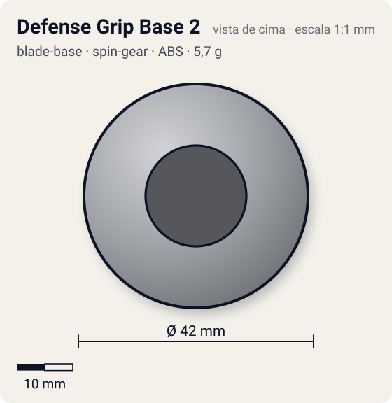
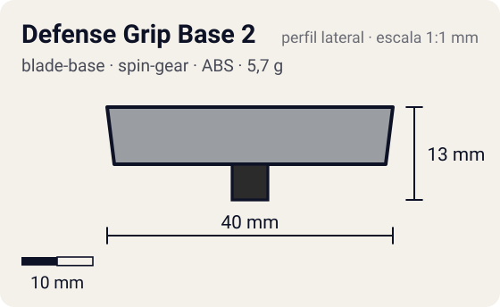

# Defense Grip Base 2

<!-- auto:inicio (gerado por npm run build:research; não edite este bloco) -->
 

| Medidas e material | |
|---|---|
| Diâmetro | 42 estimado mm |
| Altura / espessura | 13 estimado mm |
| Peso | 5,7 wiki g |
| Material | ABS + Borracha (ponta do eixo do SG) + Rolamento de aço (no SG) (metalico) |
| Estrelas Takara (A / D / S) | 3 / 2 / 1 |
| Usada em | [Wolborg 2](../../../personagens/tala/beyblades/wolborg-2/) |
<!-- auto:fim -->

Blade Base · sistema **spin-gear**

## Formato
Base cinza-prateada, redonda, com o peso distribuído na periferia e seção de eixo curta; ponta de borracha azul do SG no centro.

## Função em batalha
Excelente life after death (só perde para a Spiral Change Base): ótima para zombies e defesa.

## Gimmick: como funciona
1. O SG (Bearing Version 2) encaixa por cima; seu eixo gira num rolamento.
2. A borracha na ponta segura o piso enquanto o corpo continua girando solto sobre o rolamento.
3. O contorno redondo e o peso na borda mantêm a bey girando mesmo muito inclinada.

## Padrão de movimento no estádio
Fica no centro e resiste, roubando rotação de rivais de giro oposto. (`padrao_movimento`: centro; ponta grip, atrito de referência 0,85; a ponta vem de: spin-gear (Right SG Bearing Version 2).)

## Beys que usam
- `tala/wolborg-2` ([ficha](../../../personagens/tala/beyblades/wolborg-2/README.md))

## Medidas, material e stats
| Item | Valor | Fonte |
|---|---|---|
| Diâmetro | 42 mm | estimado |
| Altura (com ponta) | 13 mm | estimado |
| Peso | 5,7 g | wiki |
| Material | ABS + Borracha (ponta do eixo do SG), Rolamento de aço (no SG) | A ponta grip de borracha fica no eixo do Right SG (Bearing Version 2), que gira num rolamento. |
| Ponta | grip, raio 2,5 mm | estimado (tipo pela wiki/ficha da bey) |
| Ataque / Defesa / Stamina | sem stats oficiais | — |
| Cores | primária #9a9ea3, secundária #7a7f86, detalhe #3a3fa0 | foto local blade-base.jpg |

## Referências locais
- [referencia/wolborg-2-blade-base.jpg](referencia/wolborg-2-blade-base.jpg) (cópia de `personagens/tala/beyblades/wolborg-2/pecas/blade-base.jpg`)
- [referencia/wolborg-2-pecas-separadas.jpg](referencia/wolborg-2-pecas-separadas.jpg) (cópia de `personagens/tala/beyblades/wolborg-2/pecas/pecas-separadas.jpg`)

## Notas e incertezas
- Atrito de referência grip (0,85) é o da borracha contra o piso; o rolamento do SG desacopla a ponta do corpo, o que explica a stamina alta apesar da borracha.

## Fontes
- https://beyblade.fandom.com/wiki/Blade_Base_-_Defense_Grip_2
- `pesquisa-bakuten/personagens/tala/beyblades/wolborg-2/dados.json`
