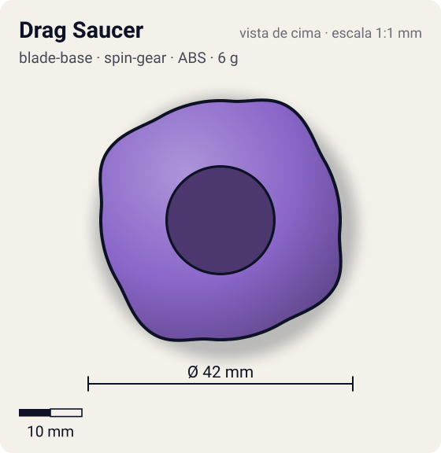
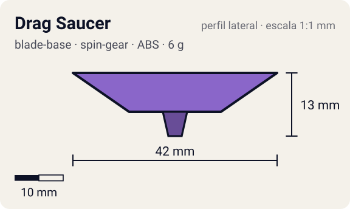

# Drag Saucer

<!-- auto:inicio (gerado por npm run build:research; não edite este bloco) -->
 

| Medidas e material | |
|---|---|
| Diâmetro | 42 estimado mm |
| Altura / espessura | 13 estimado mm |
| Peso | 6 estimado g |
| Material | ABS (opaco) |
| Estrelas Takara (A / D / S) | — |
| Usada em | [Falborg](../../../personagens/bryan-kuznetsov/beyblades/falborg/) |
<!-- auto:fim -->

Blade Base · sistema **spin-gear**

## Formato
Base da Falborg citada só na infobox da wiki ("Drag Saucer"); não tem página própria nem foto real. Na ficha do jogo de GBA aparece como base lilás/roxa de contorno arredondado.

## Função em batalha
Base de ataque presumida: pelo comportamento no anime (investidas rápidas e ricochetes na parede) supõe-se ponta semi-flat/flat.

## Gimmick: como funciona
1. Sem gimmick conhecido: base comum que segura o Right SG.

## Padrão de movimento no estádio
Estimado: movimento agressivo, percorrendo a borda do estádio e investindo contra o rival, como no anime. (`padrao_movimento`: agressivo; ponta semi-flat, atrito de referência 0,3.)

## Beys que usam
- `bryan-kuznetsov/falborg` ([ficha](../../../personagens/bryan-kuznetsov/beyblades/falborg/README.md))

## Medidas, material e stats
| Item | Valor | Fonte |
|---|---|---|
| Diâmetro | 42 mm | estimado |
| Altura (com ponta) | 13 mm | estimado |
| Peso | 6 g | estimado |
| Material | ABS | Bey exclusiva do anime: não existe brinquedo. Material presumido (padrão das bases SG). |
| Ponta | semi-flat, raio 2,5 mm | estimado (tipo pela wiki/ficha da bey) |
| Ataque / Defesa / Stamina | sem stats oficiais | — |
| Cores | primária #8a66c9, secundária #4b2e86, detalhe #d8c8f0 | estimado a partir da ficha do jogo GBA (gba-pecas-e-stats.png) |

## Referências locais
- [referencia/falborg-gba-pecas-e-stats.png](referencia/falborg-gba-pecas-e-stats.png) (cópia de `personagens/bryan-kuznetsov/beyblades/falborg/pecas/gba-pecas-e-stats.png`)

## Notas e incertezas
- Nome vem só da infobox da página Falborg; não há página "Blade Base - Drag Saucer" na wiki (o nome lembra o Sub-AR Dragon Saucer da Gaia Dragoon G, possível engano da wiki).
- Tipo de ponta, cores, peso e medidas: todos estimados.

## Fontes
- https://beyblade.fandom.com/wiki/Falborg
- `pesquisa-bakuten/personagens/bryan-kuznetsov/beyblades/falborg/dados.json`
