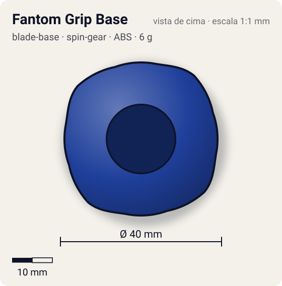
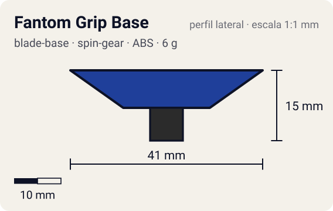

# Fantom Grip Base

<!-- auto:inicio (gerado por npm run build:research; não edite este bloco) -->
 

| Medidas e material | |
|---|---|
| Diâmetro | 40 estimado mm |
| Altura / espessura | 15 estimado mm |
| Peso | 6 estimado g |
| Material | ABS + Borracha dura (eixo grip vermelho) (opaco) |
| Estrelas Takara (A / D / S) | 4 / 1 / 0,5 |
| Usada em | [Dragoon F (Dragoon Fantom)](../../../personagens/tyson-granger/beyblades/dragoon-f/) |
<!-- auto:fim -->

Blade Base · sistema **spin-gear** · também chamada: Phantom Grip

## Formato
Base da Dragoon F com eixo grip de borracha vermelha alto ("Grip Shaft").

## Função em batalha
Ataque: tem mais borracha que a Storm Grip, mas a borracha é dura e dá menos tração; mais alta, é um pouco mais lenta e exposta por baixo.

## Gimmick: como funciona
1. Sem gimmick móvel: o Left SG encaixa por cima e o eixo de borracha fica no centro.
2. Com o desgaste da borracha a bey fica hiperagressiva e a stamina despenca.

## Padrão de movimento no estádio
Agressivo, em flower rápido pela borda (rotação esquerda na Dragoon F). (`padrao_movimento`: agressivo; ponta grip, atrito de referência 0,85.)

## Beys que usam
- `tyson-granger/dragoon-f` ([ficha](../../../personagens/tyson-granger/beyblades/dragoon-f/README.md))

## Medidas, material e stats
| Item | Valor | Fonte |
|---|---|---|
| Diâmetro | 40 mm | estimado |
| Altura (com ponta) | 15 mm | estimado |
| Peso | 6 g | estimado |
| Material | ABS + Borracha dura (eixo grip vermelho) | Eixo alto de borracha vermelha mais dura que a da Storm Grip. |
| Ponta | grip, raio 3,5 mm | estimado (tipo pela wiki/ficha da bey) |
| Ataque / Defesa / Stamina | sem stats oficiais | — |
| Cores | primária #1f3f9a, secundária #c8102e, detalhe #f2f2f2 | estimado (sem foto local) |

## Referências locais
- Nenhuma foto local desta peça no repositório.

## Notas e incertezas
- Página da wiki praticamente vazia: descrição vem da ficha da bey; peso, medidas e cores estimados.
- Atrito mantido no valor de referência grip (0,85), embora a borracha seja mais dura.

## Fontes
- https://beyblade.fandom.com/wiki/Blade_Base_-_Fantom_Grip_Base
- `pesquisa-bakuten/personagens/tyson-granger/beyblades/dragoon-f/dados.json`
