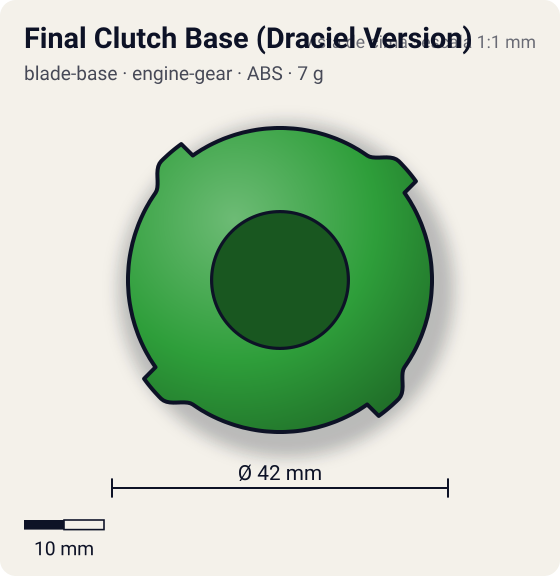
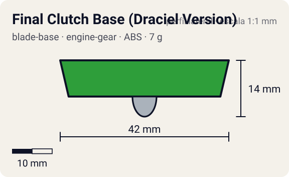

# Final Clutch Base (Draciel Version)

<!-- auto:inicio (gerado por npm run build:research; não edite este bloco) -->
 

| Medidas e material | |
|---|---|
| Diâmetro | 42 estimado mm |
| Altura / espessura | 14 estimado mm |
| Peso | 7 estimado g |
| Material | ABS + Aço (2 esferas internas) (opaco) |
| Estrelas Takara (A / D / S) | 1 / 2 / 1 |
| Usada em | [Draciel G](../../../personagens/max-tate/beyblades/draciel-g/) |
<!-- auto:fim -->

Blade Base · sistema **engine-gear** · também chamada: Hit Release (Draciel Version) (Hasbro), FC Metal Ball Ver.

## Formato
Base verde, redonda, com quatro blocos de trava nas laterais, duas esferas de metal visíveis em cima/embaixo, faixas amarelas e pretas na borda e adesivo "FC METAL BALL Ver.".

## Função em batalha
A mais leve das bases Final Clutch: guarda o motor para o fim da batalha. As esferas internas quase não mudam o desempenho e a distribuição de peso é ruim.

## Gimmick: como funciona
1. Dá-se corda no Engine Gear e encaixa-se: as travas da Final Clutch prendem o motor.
2. A bey gira com a energia do lançamento sobre a bola metálica.
3. Quando a rotação cai perto do fim, a trava abre.
4. O motor dá um último reforço de rotação, prolongando a batalha quando a rival está cansada.

| Modo | Ponta | Atrito | Gatilho |
|---|---|---|---|
| Engine Gear travado | metal-ball | 0,18 | do lançamento até a trava abrir |
| Engine Gear liberado | metal-ball | 0,18 | perto do fim da batalha, com RPM baixa (limiar não documentado) |

## Padrão de movimento no estádio
Fica no centro; após a liberação ganha rotação e um pouco de deslocamento. (`padrao_movimento`: centro; ponta metal-ball, atrito de referência 0,18; a ponta vem de: engine-gear (Right EG Metal Ball).)

## Beys que usam
- `max-tate/draciel-g` ([ficha](../../../personagens/max-tate/beyblades/draciel-g/README.md))

## Medidas, material e stats
| Item | Valor | Fonte |
|---|---|---|
| Diâmetro | 42 mm | estimado |
| Altura (com ponta) | 14 mm | estimado |
| Peso | 7 g | estimado |
| Material | ABS + Aço (2 esferas internas) | Ponta do Engine Gear (Right EG Metal Ball): bola metálica. |
| Ponta | metal-ball, raio 3 mm | estimado (tipo pela wiki/ficha da bey) |
| Ataque / Defesa / Stamina | 1 / 2 / 1 | Beyblade Wiki, Part Infobox (Hit Release (Draciel Version)) |
| Cores | primária #2e9e3a, secundária #f2c919, detalhe #1a1a1a | foto local blade-base.jpg |

## Referências locais
- [referencia/draciel-g-blade-base.jpg](referencia/draciel-g-blade-base.jpg) (cópia de `personagens/max-tate/beyblades/draciel-g/pecas/blade-base.jpg`)

## Notas e incertezas
- Peso não informado na wiki ("a mais leve das Final Clutch"; a Strata Dragoon G tem 8 g): estimado 7 g.

## Fontes
- https://beyblade.fandom.com/wiki/Blade_Base_-_Hit_Release_(Draciel_Version)
- `pesquisa-bakuten/personagens/max-tate/beyblades/draciel-g/dados.json`
