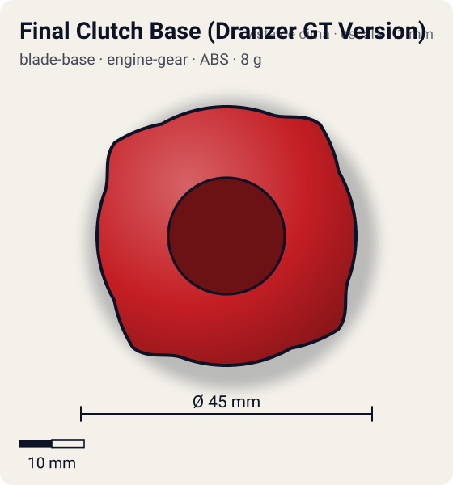
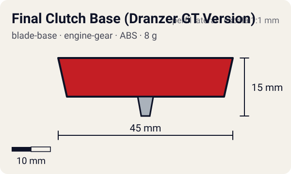

# Final Clutch Base (Dranzer GT Version)

<!-- auto:inicio (gerado por npm run build:research; não edite este bloco) -->
 

| Medidas e material | |
|---|---|
| Diâmetro | 45 estimado mm |
| Altura / espessura | 15 estimado mm |
| Peso | 8 estimado g |
| Material | ABS (opaco) |
| Estrelas Takara (A / D / S) | 2 / 2 / 2 |
| Usada em | [Dranzer GT](../../../personagens/kai-hiwatari/beyblades/dranzer-gt/) |
<!-- auto:fim -->

Blade Base · sistema **engine-gear** · também chamada: Hit Release (Dranzer GT Version) (Hasbro) · ファイナルクラッチベース (ドランザーGTバージョン)

## Formato
Base Final Clutch da Dranzer GT, redonda, com travas de embreagem laterais; trabalha com o Engine Gear "Reverse" da GT.

## Função em batalha
Solta o motor só depois de algum tempo de batalha, guardando o reforço de rotação para quando a rival enfraquece.

## Gimmick: como funciona
1. Dá-se corda no EG Reverse e encaixa-se na base: as travas prendem o motor.
2. A bey gira pela energia do lançamento.
3. Com a queda de RPM (ou um impacto forte), a trava abre e o motor passa a girar a ponta.
4. A ponta metal semi-flat ganha velocidade e a bey muda para movimento agressivo.

| Modo | Ponta | Atrito | Gatilho |
|---|---|---|---|
| Engine Gear travado | metal-semi-flat | 0,25 | do lançamento até a trava abrir |
| Engine Gear liberado | metal-semi-flat | 0,25 | RPM baixa na parte final da batalha (limiar não documentado) ou impacto (Hit Release) |

## Padrão de movimento no estádio
Órbita moderada no início e disparada depois da liberação. (`padrao_movimento`: agressivo; ponta metal-semi-flat, atrito de referência 0,25; a ponta vem de: engine-gear (Right EG Reverse, CEW Metal Semi-Flat).)

## Beys que usam
- `kai-hiwatari/dranzer-gt` ([ficha](../../../personagens/kai-hiwatari/beyblades/dranzer-gt/README.md))

## Medidas, material e stats
| Item | Valor | Fonte |
|---|---|---|
| Diâmetro | 45 mm | estimado |
| Altura (com ponta) | 15 mm | estimado |
| Peso | 8 g | estimado |
| Material | ABS | Ponta do Engine Gear (Right EG Reverse com CEW Metal Semi-Flat): metal. |
| Ponta | metal-semi-flat, raio 2 mm | estimado (tipo pela wiki/ficha da bey) |
| Ataque / Defesa / Stamina | 2 / 2 / 2 | Beyblade Wiki, Part Infobox (Hit Release (Dranzer GT Version)) |
| Cores | primária #c41e24, secundária #1a1a1a, detalhe #d9d9d9 | estimado (sem foto local) |

## Referências locais
- Nenhuma foto local desta peça no repositório.

## Notas e incertezas
- Ficha da bey diz que a liberação acontece "no meio da batalha"; a wiki não detalha. Registrado como limiar de RPM não documentado.
- Peso, medidas e cores estimados.

## Fontes
- https://beyblade.fandom.com/wiki/Blade_Base_-_Hit_Release_(Dranzer_GT_Version)
- `pesquisa-bakuten/personagens/kai-hiwatari/beyblades/dranzer-gt/dados.json`
