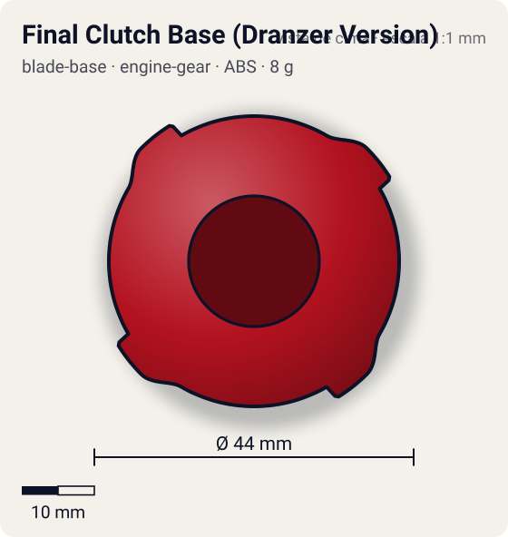
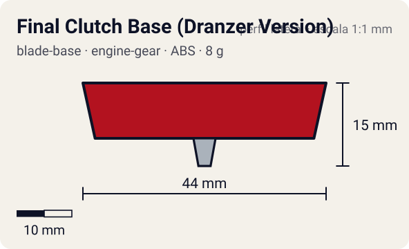

# Final Clutch Base (Dranzer Version)

<!-- auto:inicio (gerado por npm run build:research; não edite este bloco) -->
 

| Medidas e material | |
|---|---|
| Diâmetro | 44 estimado mm |
| Altura / espessura | 15 estimado mm |
| Peso | 8 estimado g |
| Material | ABS (opaco) |
| Estrelas Takara (A / D / S) | 2 / 0 / 1 |
| Usada em | [Dranzer G](../../../personagens/kai-hiwatari/beyblades/dranzer-g/) |
<!-- auto:fim -->

Blade Base · sistema **engine-gear** · também chamada: Hit Release (Dranzer Version) (Hasbro) · ファイナルクラッチベース (ドランザーバージョン)

## Formato
Base Final Clutch da Dranzer G: corpo redondo com quatro blocos quadrados laterais (lembram os Support Parts da V2) que abrigam as alavancas da embreagem.

## Função em batalha
Guarda o motor do Engine Gear para um surto de velocidade tardio, quando a rival já está mais lenta.

## Gimmick: como funciona
1. Dá-se corda no Engine Gear e ele trava na base pelas alavancas da Final Clutch.
2. A bey gira com a energia do lançamento sobre a ponta metal semi-flat.
3. Quando a rotação cai ou as alavancas levam um impacto (bater na parede ou na rival), a trava abre.
4. O motor gira o eixo da ponta e a bey dispara.

| Modo | Ponta | Atrito | Gatilho |
|---|---|---|---|
| Engine Gear travado | metal-semi-flat | 0,25 | do lançamento até a trava abrir |
| Engine Gear liberado | metal-semi-flat | 0,25 | RPM baixa no fim da batalha (limiar não documentado) ou impacto nas alavancas (Hit Release) |

## Padrão de movimento no estádio
Semi-flat metálico: órbita moderada; após a liberação, investidas rápidas e agressivas. (`padrao_movimento`: agressivo; ponta metal-semi-flat, atrito de referência 0,25; a ponta vem de: engine-gear (Right EG Metal Semi-Flat).)

## Beys que usam
- `kai-hiwatari/dranzer-g` ([ficha](../../../personagens/kai-hiwatari/beyblades/dranzer-g/README.md))

## Medidas, material e stats
| Item | Valor | Fonte |
|---|---|---|
| Diâmetro | 44 mm | estimado |
| Altura (com ponta) | 15 mm | estimado |
| Peso | 8 g | estimado |
| Material | ABS | Ponta do Engine Gear (Right EG Metal Semi-Flat): metal. |
| Ponta | metal-semi-flat, raio 2 mm | estimado (tipo pela wiki/ficha da bey) |
| Ataque / Defesa / Stamina | 2 / — / 1 | Beyblade Wiki, Part Infobox (defesa em branco) |
| Cores | primária #b3121f, secundária #1a1a1a, detalhe #f2b705 | estimado (sem foto local) |

## Referências locais
- Nenhuma foto local desta peça no repositório.

## Notas e incertezas
- Também usada em Rapid Eagle G e Apollon G (wiki).
- Peso, medidas e cores estimados (wiki sem peso; sem foto local).

## Fontes
- https://beyblade.fandom.com/wiki/Blade_Base_-_Hit_Release_(Dranzer_Version)
- `pesquisa-bakuten/personagens/kai-hiwatari/beyblades/dranzer-g/dados.json`
