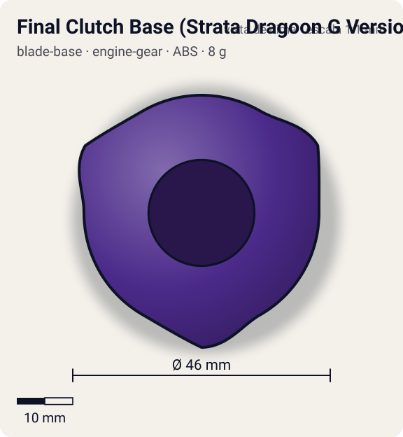
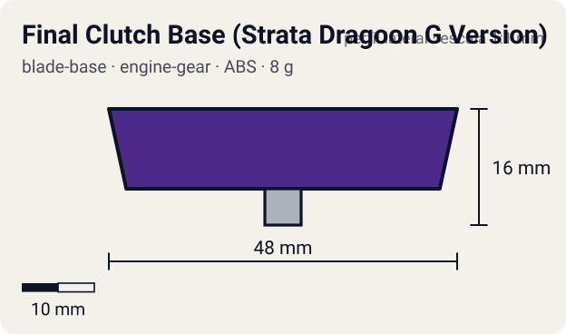

# Final Clutch Base (Strata Dragoon G Version)

<!-- auto:inicio (gerado por npm run build:research; não edite este bloco) -->
 

| Medidas e material | |
|---|---|
| Diâmetro | 46 estimado mm |
| Altura / espessura | 16 estimado mm |
| Peso | 8 wiki g |
| Material | ABS (opaco) |
| Estrelas Takara (A / D / S) | 1 / 2 / 1 |
| Usada em | [Gaia Dragoon G (Strata Dragoon G / Great)](../../../personagens/daichi-sumeragi/beyblades/gaia-dragoon-g/) |
<!-- auto:fim -->

Blade Base · sistema **engine-gear** · também chamada: Hit Release (Strata Dragoon G Version) (Hasbro)

## Formato
Base alta, roxa, com adesivo vermelho "GAIA DRAGOON" no topo e abas triangulares salientes na borda marcadas "FC BASE" (lembram os Support Parts da Burning Kerberous). Furo central grande para o Engine Gear.

## Função em batalha
Segura o Engine Gear travado e o libera tarde na batalha, dando um surto de velocidade quando a rival já perdeu rotação. A altura a deixa exposta a upper attack e o movimento depois da liberação é pouco controlável.

## Gimmick: como funciona
1. Dá-se corda no Engine Gear e encaixa-se na base; as travas da Final Clutch prendem o motor.
2. Durante a maior parte da batalha a bey gira só com a energia do lançamento, ponta metal flat no piso.
3. Quando a rotação cai (ou quando as abas recebem uma pancada forte, daí o nome Hasbro "Hit Release"), a trava abre.
4. O motor solta a corda e gira o eixo da ponta: a bey ganha uma arrancada e sai correndo pelo estádio.

| Modo | Ponta | Atrito | Gatilho |
|---|---|---|---|
| Engine Gear travado | metal-flat | 0,4 | do lançamento até a trava abrir |
| Engine Gear liberado | metal-flat | 0,4 | RPM baixa no fim da batalha (trava Final Clutch; limiar não documentado) ou impacto forte nas abas triangulares (Hit Release) |

## Padrão de movimento no estádio
Antes da liberação: metal flat, órbita moderada. Depois: disparada errática pelo estádio, difícil de prever. (`padrao_movimento`: erratico; ponta metal-flat, atrito de referência 0,4; a ponta vem de: engine-gear (Right EG Metal Flat).)

## Beys que usam
- `daichi-sumeragi/gaia-dragoon-g` ([ficha](../../../personagens/daichi-sumeragi/beyblades/gaia-dragoon-g/README.md))

## Medidas, material e stats
| Item | Valor | Fonte |
|---|---|---|
| Diâmetro | 46 mm | estimado |
| Altura (com ponta) | 16 mm | estimado |
| Peso | 8 g | wiki |
| Material | ABS | Ponta é do Engine Gear (Right EG Metal Flat): eixo metálico. |
| Ponta | metal-flat, raio 2,5 mm | estimado (tipo pela wiki/ficha da bey) |
| Ataque / Defesa / Stamina | 1 / 2 / 1 | Beyblade Wiki, Part Infobox (Hit Release (Strata Dragoon G Version)) |
| Cores | primária #4b2a8a, secundária #e0322b, detalhe #ffffff | foto local blade-base.jpg |

## Referências locais
- [referencia/gaia-dragoon-g-blade-base.jpg](referencia/gaia-dragoon-g-blade-base.jpg) (cópia de `personagens/daichi-sumeragi/beyblades/gaia-dragoon-g/pecas/blade-base.jpg`)
- [referencia/gaia-dragoon-g-montada-lateral.jpg](referencia/gaia-dragoon-g-montada-lateral.jpg) (cópia de `personagens/daichi-sumeragi/beyblades/gaia-dragoon-g/pecas/montada-lateral.jpg`)

## Notas e incertezas
- A wiki diz que ela "libera o Engine Gear quando é atingida"; o nome Takara (Final Clutch) indica liberação no fim da batalha. Registramos os dois gatilhos.
- Simetria 3 inferida da foto (abas a ~120°).

## Fontes
- https://beyblade.fandom.com/wiki/Blade_Base_-_Hit_Release_(Strata_Dragoon_G_Version)
- `pesquisa-bakuten/personagens/daichi-sumeragi/beyblades/gaia-dragoon-g/dados.json`
