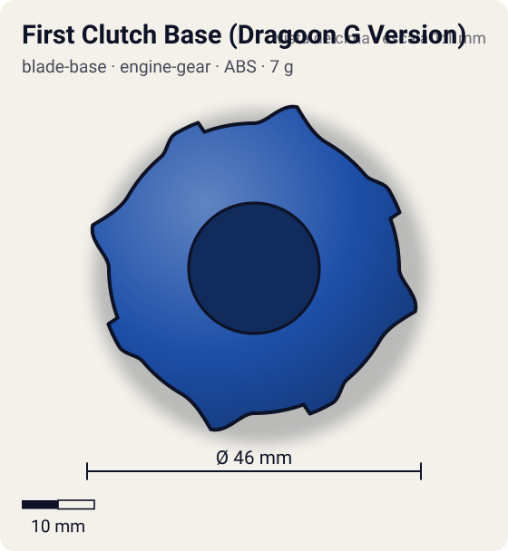
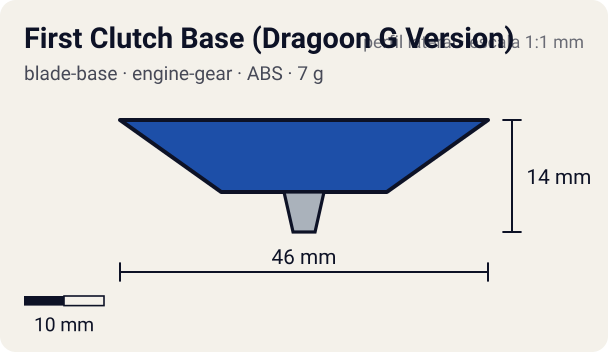

# First Clutch Base (Dragoon G Version)

<!-- auto:inicio (gerado por npm run build:research; não edite este bloco) -->
 

| Medidas e material | |
|---|---|
| Diâmetro | 46 estimado mm |
| Altura / espessura | 14 estimado mm |
| Peso | 7 wiki g |
| Material | ABS (opaco) |
| Estrelas Takara (A / D / S) | 3 / 0 / 0 |
| Usada em | [Dragoon G (Dragoon Galaxy)](../../../personagens/tyson-granger/beyblades/dragoon-g/) |
<!-- auto:fim -->

Blade Base · sistema **engine-gear** · também chamada: Instant Release (Dragoon G Version) (Hasbro) · ファーストクラッチベース

## Formato
Primeira base Instant Release (dez/2002): oito saliências, quatro grandes parecidas com as do Eight Spiker e quatro menores sem espinho.

## Função em batalha
Solta o motor logo no lançamento; as saliências alcançam beys baixas, mas sofrem muito recoil.

## Gimmick: como funciona
1. Dá-se corda no Left EG e encaixa-se na base.
2. A trava First Clutch segura o motor só no lançador.
3. No pouso o motor é liberado e gira a ponta: arrancada imediata em rotação esquerda.

| Modo | Ponta | Atrito | Gatilho |
|---|---|---|---|
| Engine Gear travado | metal-semi-flat | 0,25 | só no lançador |
| Engine Gear liberado | metal-semi-flat | 0,25 | pouso no estádio, logo após o lançamento |

## Padrão de movimento no estádio
Agressivo desde o começo, com ricochetes por causa das saliências. (`padrao_movimento`: agressivo; ponta metal-semi-flat, atrito de referência 0,25; a ponta vem de: engine-gear (Left EG, CEW Metal Semi-Flat).)

## Beys que usam
- `tyson-granger/dragoon-g` ([ficha](../../../personagens/tyson-granger/beyblades/dragoon-g/README.md))

## Medidas, material e stats
| Item | Valor | Fonte |
|---|---|---|
| Diâmetro | 46 mm | estimado |
| Altura (com ponta) | 14 mm | estimado |
| Peso | 7 g | wiki |
| Material | ABS | Ponta do Engine Gear (Left EG, CEW Metal Semi-Flat): metal. |
| Ponta | metal-semi-flat, raio 2,5 mm | estimado (tipo pela wiki/ficha da bey) |
| Ataque / Defesa / Stamina | 3 / — / — | Beyblade Wiki, Part Infobox (defesa e stamina em branco) |
| Cores | primária #1d4fa8, secundária #f2f2f2, detalhe #c8102e | estimado (sem foto local) |

## Referências locais
- Nenhuma foto local desta peça no repositório.

## Notas e incertezas
- Ficha da bey diz ponta "flat (metal, bordas arredondadas)"; a peça spin_gear é "Left Engine Gear (CEW Metal Semi-Flat)". Adotado metal-semi-flat.
- Cores estimadas.

## Fontes
- https://beyblade.fandom.com/wiki/Blade_Base_-_Instant_Release_(Dragoon_G_Version)
- `pesquisa-bakuten/personagens/tyson-granger/beyblades/dragoon-g/dados.json`
