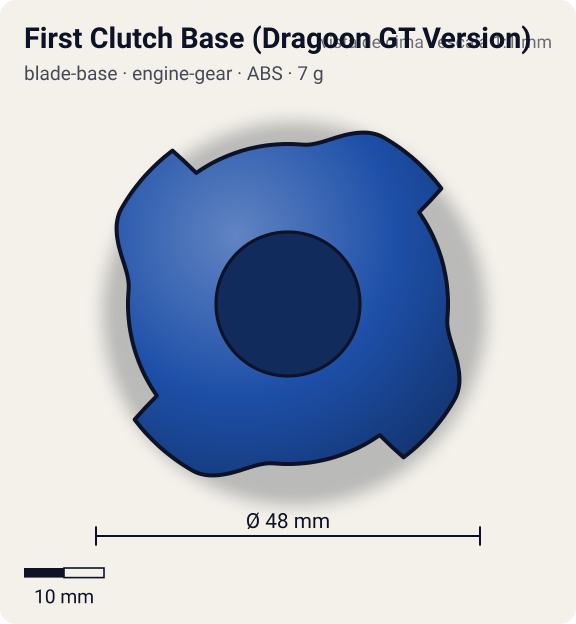
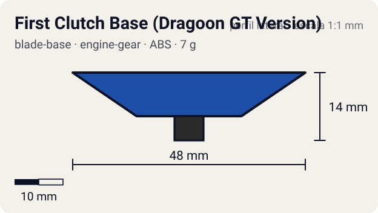

# First Clutch Base (Dragoon GT Version)

<!-- auto:inicio (gerado por npm run build:research; não edite este bloco) -->
 

| Medidas e material | |
|---|---|
| Diâmetro | 48 estimado mm |
| Altura / espessura | 14 estimado mm |
| Peso | 7 wiki g |
| Material | ABS (opaco) |
| Estrelas Takara (A / D / S) | 3 / 1 / 1 |
| Usada em | [Dragoon GT (Dragoon Galaxy Turbo)](../../../personagens/tyson-granger/beyblades/dragoon-gt/) |
<!-- auto:fim -->

Blade Base · sistema **engine-gear** · também chamada: Instant Release (Dragoon GT Version) (Hasbro)

## Formato
Base Instant Release com quatro lâminas grandes e planas (forma parecida com o Spike Dragon da Dragoon V2).

## Função em batalha
Solta o motor no lançamento; as lâminas dão smash attack mas geram muito recoil e podem quebrar.

## Gimmick: como funciona
1. Dá-se corda no EG Turbo e encaixa-se.
2. A trava First Clutch prende o motor só no lançador.
3. No pouso o motor gira a ponta grip: arrancada imediata.

| Modo | Ponta | Atrito | Gatilho |
|---|---|---|---|
| Engine Gear travado | grip | 0,85 | só no lançador |
| Engine Gear liberado | grip | 0,85 | pouso no estádio, logo após o lançamento |

## Padrão de movimento no estádio
Agressivo, com ricochetes; bom só para tentar KO de um golpe. (`padrao_movimento`: agressivo; ponta grip, atrito de referência 0,85; a ponta vem de: engine-gear (Left EG Turbo, CEW Metal Grip).)

## Beys que usam
- `tyson-granger/dragoon-gt` ([ficha](../../../personagens/tyson-granger/beyblades/dragoon-gt/README.md))

## Medidas, material e stats
| Item | Valor | Fonte |
|---|---|---|
| Diâmetro | 48 mm | estimado |
| Altura (com ponta) | 14 mm | estimado |
| Peso | 7 g | wiki |
| Material | ABS | Ponta do Engine Gear Turbo (CEW Metal Grip): borracha. |
| Ponta | grip, raio 3 mm | estimado (tipo pela wiki/ficha da bey) |
| Ataque / Defesa / Stamina | 3 / 1 / 1 | Beyblade Wiki, Part Infobox (First Clutch Base (Dragoon GT Version)) |
| Cores | primária #1d4fa8, secundária #f2f2f2, detalhe #f2b705 | estimado (sem foto local) |

## Referências locais
- Nenhuma foto local desta peça no repositório.

## Notas e incertezas
- Também na Trygle 2 G (wiki).
- Cores estimadas.

## Fontes
- https://beyblade.fandom.com/wiki/Blade_Base_-_First_Clutch_Base_(Dragoon_GT_Version)
- https://beyblade.fandom.com/wiki/Blade_Base_-_Instant_Release_(Dragoon_GT_Version)
- `pesquisa-bakuten/personagens/tyson-granger/beyblades/dragoon-gt/dados.json`
