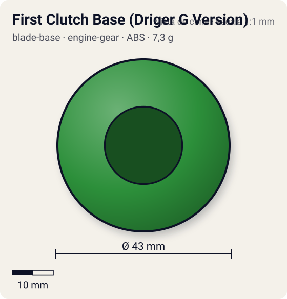
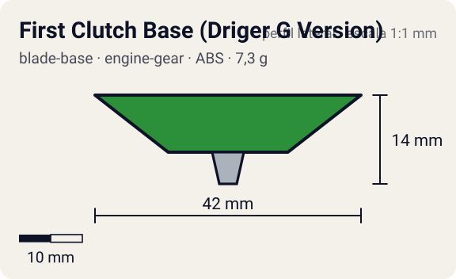

# First Clutch Base (Driger G Version)

<!-- auto:inicio (gerado por npm run build:research; não edite este bloco) -->
 

| Medidas e material | |
|---|---|
| Diâmetro | 43 estimado mm |
| Altura / espessura | 14 estimado mm |
| Peso | 7,3 wiki g |
| Material | ABS (opaco) |
| Estrelas Takara (A / D / S) | 1 / 2 / 0 |
| Usada em | [Driger G](../../../personagens/ray-kon/beyblades/driger-g/) |
<!-- auto:fim -->

Blade Base · sistema **engine-gear** · também chamada: Instant Release (Driger G Version) (Hasbro)

## Formato
Base circular e lisa, com fundo inclinado e suave. Projetada para defesa: o contorno redondo desvia golpes.

## Função em batalha
Libera o Engine Gear logo no início; o formato redondo dá algum life after death, mas o volume impede uso ofensivo.

## Gimmick: como funciona
1. Dá-se corda no Engine Gear e encaixa-se na base.
2. A trava First Clutch segura o motor só enquanto a bey está no lançador.
3. Ao pousar, o motor é solto e gira a ponta metal semi-flat: arrancada imediata.

| Modo | Ponta | Atrito | Gatilho |
|---|---|---|---|
| Engine Gear travado | metal-semi-flat | 0,25 | só no lançador |
| Engine Gear liberado | metal-semi-flat | 0,25 | pouso no estádio, logo após o lançamento |

## Padrão de movimento no estádio
Arrancada agressiva no início; depois órbita moderada. (`padrao_movimento`: agressivo; ponta metal-semi-flat, atrito de referência 0,25; a ponta vem de: engine-gear (Right EG Metal Semi-Flat).)

## Beys que usam
- `ray-kon/driger-g` ([ficha](../../../personagens/ray-kon/beyblades/driger-g/README.md))

## Medidas, material e stats
| Item | Valor | Fonte |
|---|---|---|
| Diâmetro | 43 mm | estimado |
| Altura (com ponta) | 14 mm | estimado |
| Peso | 7,3 g | wiki |
| Material | ABS | Ponta do Engine Gear (Right EG Metal Semi-Flat): metal. |
| Ponta | metal-semi-flat, raio 2,5 mm | estimado (tipo pela wiki/ficha da bey) |
| Ataque / Defesa / Stamina | 1 / — / 2 | Beyblade Wiki, Part Infobox (defesa em branco) |
| Cores | primária #2c8f3a, secundária #1a1a1a, detalhe #f2c919 | estimado (sem foto local) |

## Referências locais
- Nenhuma foto local desta peça no repositório.

## Notas e incertezas
- Cores e medidas estimadas.

## Fontes
- https://beyblade.fandom.com/wiki/Blade_Base_-_Instant_Release_(Driger_G_Version)
- `pesquisa-bakuten/personagens/ray-kon/beyblades/driger-g/dados.json`
