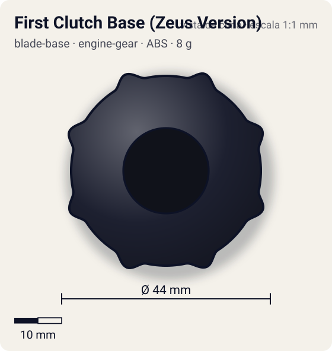
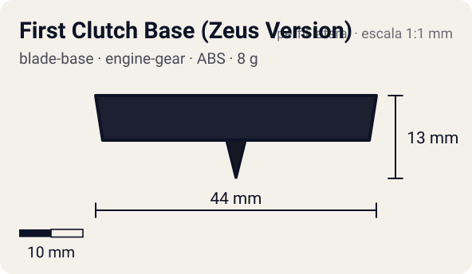

# First Clutch Base (Zeus Version)

<!-- auto:inicio (gerado por npm run build:research; não edite este bloco) -->
 

| Medidas e material | |
|---|---|
| Diâmetro | 44 estimado mm |
| Altura / espessura | 13 estimado mm |
| Peso | 8 estimado g |
| Material | ABS (opaco) |
| Estrelas Takara (A / D / S) | 0 / 3 / 2 |
| Usada em | [Zeus](../../../personagens/brooklyn-masefield/beyblades/zeus/) |
<!-- auto:fim -->

Blade Base · sistema **engine-gear**

## Formato
Base redonda e pesada, preta-azulada, com aro defensivo de oito nódulos e fluxo aberto (vazados) entre eles. Adesivos azuis "BEYBLADE ZEUS" em volta do furo central, por onde sai a ponta do Spin/Engine Gear.

## Função em batalha
Dá peso e boa distribuição de massa para a Zeus (tipo stamina). A embreagem First Clutch só tem efeito se um Engine Gear for instalado: aí o motor é liberado logo no começo da batalha.

## Gimmick: como funciona
1. O Spin Gear (ou Engine Gear) encaixa por cima e fica preso pelos clipes da base.
2. Com um Engine Gear com corda, a trava da embreagem First Clutch segura o motor enquanto a bey está no lançador.
3. Ao tocar o estádio, a trava se solta imediatamente e o motor passa a girar o eixo da ponta, dando uma arrancada logo no início.
4. No estoque Takara (Customize Gear de eixo livre, sem motor) não há liberação: a base funciona como base comum.

| Modo | Ponta | Atrito | Gatilho |
|---|---|---|---|
| Sem Engine Gear (estoque Takara: Customize Gear sem motor) | sharp | 0,1 | nenhum: a base só segura o SG |
| Com Engine Gear: liberação imediata | sharp | 0,1 | pouso no estádio, logo após o lançamento (First Clutch) |

## Padrão de movimento no estádio
Com a ponta Light Sharp, fica parada perto do centro do estádio, girando estável; o aro de oito nódulos ajuda a desviar golpes. Com EG a arrancada inicial a tira do centro por alguns segundos. (`padrao_movimento`: centro; ponta sharp, atrito de referência 0,1; a ponta vem de: spin-gear (CEW Light Sharp do Customize Gear).)

## Beys que usam
- `brooklyn-masefield/zeus` ([ficha](../../../personagens/brooklyn-masefield/beyblades/zeus/README.md))

## Medidas, material e stats
| Item | Valor | Fonte |
|---|---|---|
| Diâmetro | 44 mm | estimado |
| Altura (com ponta) | 13 mm | estimado |
| Peso | 8 g | estimado |
| Material | ABS | Corpo de ABS preto-azulado. A ponta não é da base: no Zeus Takara vem do Customize Gear com o CEW Light Sharp (plástico vermelho); a Hasbro usa Right EG com ponta Metal Ball. |
| Ponta | sharp, raio 1,5 mm | estimado (tipo pela wiki/ficha da bey) |
| Ataque / Defesa / Stamina | — / 3 / 2 | Beyblade Wiki, Part Infobox (ataque em branco) |
| Cores | primária #1d2030, secundária #2c5fb5, detalhe #d9d9d9 | foto local montada-inferior.jpg |

## Referências locais
- [referencia/zeus-montada-inferior.jpg](referencia/zeus-montada-inferior.jpg) (cópia de `personagens/brooklyn-masefield/beyblades/zeus/pecas/montada-inferior.jpg`)
- [referencia/zeus-caixa-verso-pecas.jpg](referencia/zeus-caixa-verso-pecas.jpg) (cópia de `personagens/brooklyn-masefield/beyblades/zeus/pecas/caixa-verso-pecas.jpg`)

## Notas e incertezas
- Peso e medidas não constam na wiki: estimados para uma base de EG redonda e "pesada".
- A wiki descreve o aro com oito nódulos ("eight nodules"); a simetria 8 da forma vem daí.

## Fontes
- https://beyblade.fandom.com/wiki/Blade_Base_-_First_Clutch_Base_(Zeus_Version)
- `pesquisa-bakuten/personagens/brooklyn-masefield/beyblades/zeus/dados.json`
