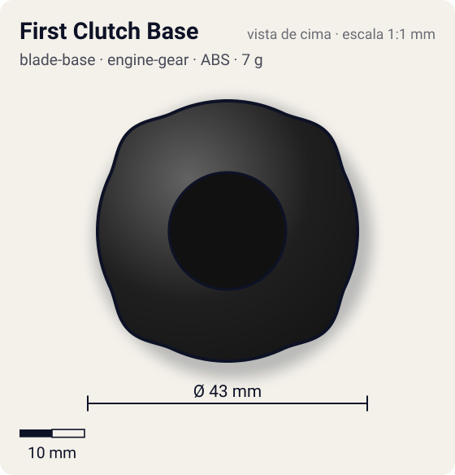
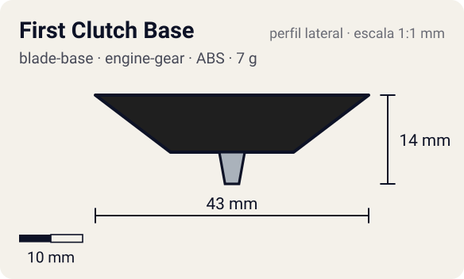

# First Clutch Base

<!-- auto:inicio (gerado por npm run build:research; não edite este bloco) -->
 

| Medidas e material | |
|---|---|
| Diâmetro | 43 estimado mm |
| Altura / espessura | 14 estimado mm |
| Peso | 7 estimado g |
| Material | ABS (opaco) |
| Estrelas Takara (A / D / S) | 3 / 1 / 1 |
| Usada em | [Galeon 2 (Engine Gear)](../../../personagens/lee/beyblades/galeon-2-eg/) |
<!-- auto:fim -->

Blade Base · sistema **engine-gear** · também chamada: Instant Release Base (Hasbro) · ファーストクラッチベース

## Formato
Base genérica de liberação imediata (Instant Release) do sistema Engine Gear, como aparece na Galeon 2 de Engine Gear do anime.

## Função em batalha
Solta o motor do Engine Gear logo que a bey toca o estádio, para arrancar agressiva desde o início.

## Gimmick: como funciona
1. Dá-se corda no Engine Gear e encaixa-se na base.
2. A trava First Clutch segura o motor só enquanto a bey está no lançador.
3. Ao pousar, a trava abre e o motor gira a ponta imediatamente.

| Modo | Ponta | Atrito | Gatilho |
|---|---|---|---|
| Engine Gear travado | metal-semi-flat | 0,25 | só no lançador |
| Engine Gear liberado | metal-semi-flat | 0,25 | pouso no estádio, logo após o lançamento |

## Padrão de movimento no estádio
Agressivo desde o começo, perdendo o reforço do motor cedo. (`padrao_movimento`: agressivo; ponta metal-semi-flat, atrito de referência 0,25; a ponta vem de: engine-gear (Right EG Metal Semi-Flat).)

## Beys que usam
- `lee/galeon-2-eg` ([ficha](../../../personagens/lee/beyblades/galeon-2-eg/README.md))

## Medidas, material e stats
| Item | Valor | Fonte |
|---|---|---|
| Diâmetro | 43 mm | estimado |
| Altura (com ponta) | 14 mm | estimado |
| Peso | 7 g | estimado |
| Material | ABS | Ponta do Engine Gear (Right EG Metal Semi-Flat): metal. |
| Ponta | metal-semi-flat, raio 2 mm | estimado (tipo pela wiki/ficha da bey) |
| Ataque / Defesa / Stamina | sem stats oficiais | — |
| Cores | primária #1f1f1f, secundária #c9a227, detalhe #c0c0c0 | estimado (bey exclusiva do anime) |

## Referências locais
- Nenhuma foto local desta peça no repositório.

## Notas e incertezas
- Galeon 2 (Engine Gear) é exclusiva do anime: não existe molde real. Ficha genérica; stats do artigo geral (A3 D1 S1) não foram usados por se referirem às versões de brinquedo.
- Tudo estimado, exceto o funcionamento da First Clutch (wiki).

## Fontes
- https://beyblade.fandom.com/wiki/Blade_Base_-_First_Clutch_Base
- https://beyblade.fandom.com/wiki/Galeon_2_(Engine_Gear)
- `pesquisa-bakuten/personagens/lee/beyblades/galeon-2-eg/dados.json`
