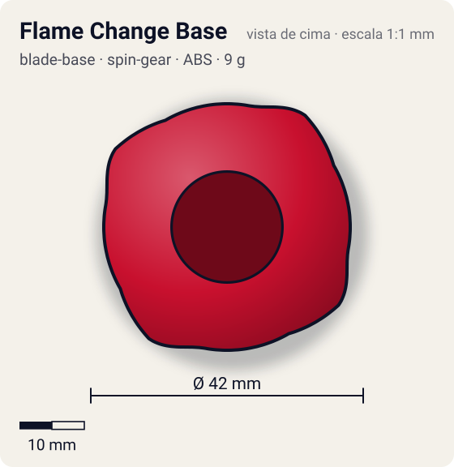
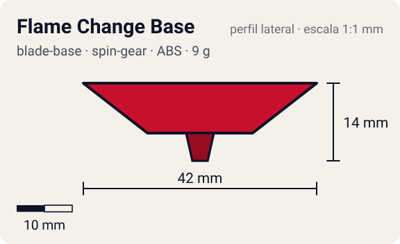

# Flame Change Base

<!-- auto:inicio (gerado por npm run build:research; não edite este bloco) -->
 

| Medidas e material | |
|---|---|
| Diâmetro | 42 estimado mm |
| Altura / espessura | 14 estimado mm |
| Peso | 9 wiki g |
| Material | ABS (opaco) |
| Estrelas Takara (A / D / S) | 3 / 2 / 3 |
| Usada em | [Dranzer F (Dranzer Flame) - emprestada](../../../personagens/tyson-granger/beyblades/dranzer-f/), [Black Dranzer](../../../personagens/kai-hiwatari/beyblades/black-dranzer/), [Dranzer F](../../../personagens/kai-hiwatari/beyblades/dranzer-f/) |
<!-- auto:fim -->

Blade Base · sistema **spin-gear**

## Formato
Base da Dranzer F feita só para o Right SG (Triple Change Version). Na parte de baixo fica o seletor de três pontas.

## Função em batalha
Permite escolher antes da batalha entre três pontas: ataque (flat), equilíbrio (semi-flat) e sobrevivência (sharp). Fora isso não tem recursos notáveis.

## Gimmick: como funciona
1. O Right SG (Triple Change Version) encaixa na base; só ele é compatível.
2. Antes do lançamento, gira-se o seletor na parte de baixo até a posição desejada.
3. A posição escolhida expõe uma das três pontas no centro (flat, semi-flat ou sharp).
4. A ponta fica fixa durante a batalha: a troca é só manual.

| Modo | Ponta | Atrito | Gatilho |
|---|---|---|---|
| Attack | flat | 0,5 | manual: girar o seletor antes do lançamento |
| Balance | semi-flat | 0,3 | manual: girar o seletor antes do lançamento |
| Survival | sharp | 0,1 | manual: girar o seletor antes do lançamento |

## Padrão de movimento no estádio
Depende do modo: flat = flower rápido pela borda; semi-flat = órbita moderada; sharp = parada no centro. (`padrao_movimento`: flower; ponta semi-flat, atrito de referência 0,3; a ponta vem de: conjunto base + Right SG (Triple Change Version).)

## Beys que usam
- `kai-hiwatari/black-dranzer` ([ficha](../../../personagens/kai-hiwatari/beyblades/black-dranzer/README.md))
- `kai-hiwatari/dranzer-f` ([ficha](../../../personagens/kai-hiwatari/beyblades/dranzer-f/README.md))
- `tyson-granger/dranzer-f` ([ficha](../../../personagens/tyson-granger/beyblades/dranzer-f/README.md))

## Medidas, material e stats
| Item | Valor | Fonte |
|---|---|---|
| Diâmetro | 42 mm | estimado |
| Altura (com ponta) | 14 mm | estimado |
| Peso | 9 g | wiki |
| Material | ABS | Pontas de plástico (seletor do Right SG Triple Change Version). |
| Ponta | semi-flat, raio 2,5 mm | estimado (tipo pela wiki/ficha da bey) |
| Ataque / Defesa / Stamina | sem stats oficiais | — |
| Cores | primária #c8102e, secundária #f2f2f2, detalhe #1a1a1a | estimado (sem foto local) |

## Referências locais
- Nenhuma foto local desta peça no repositório.

## Notas e incertezas
- A wiki diz apenas que a base "só funciona com o SG Triple Change Version"; os três modos vêm das fichas das beys (dados.json/README) e da comparação da wiki com o Delta Drive (Metal Fight). Detalhe do seletor: comunidade/estimado.
- Black Dranzer usa o mesmo molde em preto: uma ficha com variante de cor.
- Cores da Dranzer F estimadas (sem foto local).

## Fontes
- https://beyblade.fandom.com/wiki/Blade_Base_-_Flame_Change_Base
- `pesquisa-bakuten/personagens/kai-hiwatari/beyblades/black-dranzer/dados.json`
- `pesquisa-bakuten/personagens/kai-hiwatari/beyblades/dranzer-f/dados.json`
- `pesquisa-bakuten/personagens/tyson-granger/beyblades/dranzer-f/dados.json`
